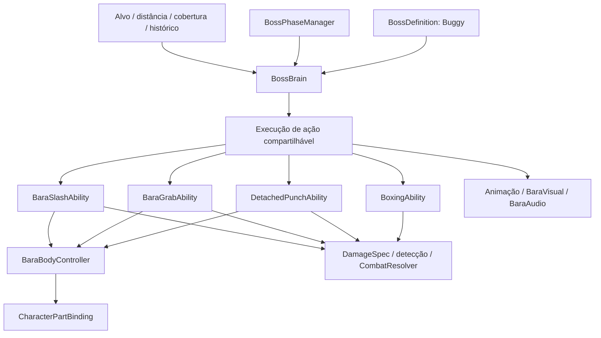
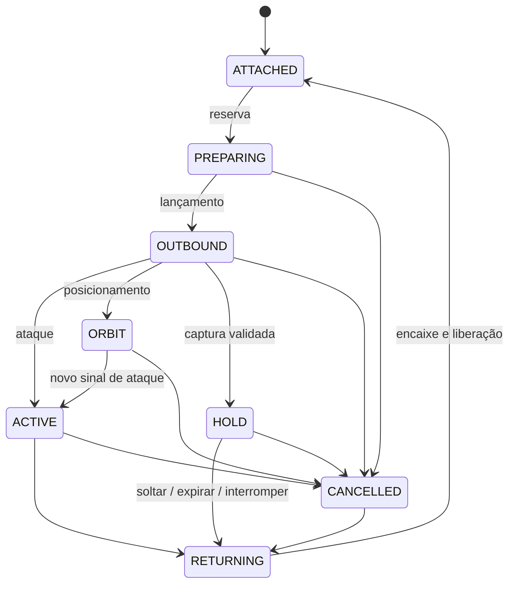

# Buggy: inventário Bara Bara e projeto de combate

> Estado da implementação em 12/09/2026: base do Boss e primeiro jab concluídos na arena normal. Este arquivo continua sendo o design do kit completo; execução, testes e pendências em [BOSS_BUGGY_PROGRESS.md](BOSS_BUGGY_PROGRESS.md).
Data: 2026-09-12. Complemento do `BOSS_BUGGY_IMPLEMENTATION_PLAN.md`.

**Estado:** auditoria de código e proposta de implementação futura. Este
documento não significa que o Boss, as partes independentes ou as novas skills
estejam implementados. A integração do modelo é uma frente separada. Não houve
alteração de scripts nesta auditoria.

Os requisitos são preservar o legado, criar boxe reconhecível, organizar a Bara
em separação/ofensiva/cortes e permitir três fases com contrajogo. Nomes de
habilidades, distâncias, tempos e thresholds abaixo são propostas para playtest,
não decisões de balanceamento já validadas.

## 1. Fontes e arquitetura existente

Foram consultados `AGENTES.md`, `ESTADO_ATUAL.md`, `erros.md`,
`LISTA_DE_CORRECOES.md`, `frutas/bara_bara.md`, `frutas/README.md`,
`AUDITORIA_FRUTAS.md`, registros históricos e os arquivos relacionados abaixo.
O código prevalece sobre descrições históricas divergentes.

A árvore usa `Player.gd`, `src/player/cast_controller.gd`, HSM do Player,
`Balance`, `DamageSpec`, `DamageZone` e `CombatResolver`. A varredura de scripts
não encontrou uma classe `CombatExecutor`, nem estados `HIT_GAP`/`TETHERED`.
Os nomes citados no pedido são conceitos a mapear, não uma API confirmada.

`src/player/hsm/CombatStateAttackStartup.gd`, `CombatStateAttackActive.gd` e
`CombatStateAttackRecovery.gd` já separam fases do M1. Não instanciar toda a
máquina de Player no Boss: ela conhece entrada e estado específico do jogador.
Reutilizar contratos e extrair execução compartilhada somente no ponto em que
uma primeira ação de Boss demonstrar a necessidade.

## 2. Bara Bara atual: inventário completo por responsabilidade

| Responsabilidade | Arquivo e ponto de entrada | Evidência |
|---|---|---|
| Catálogo e nomes da barra | `SkillSystem.gd`, entrada `bara_bara` | Z Dismantle, X Buggy Ball, C Cleave, V Shrine. |
| Dano | `src/combat/Balance.gd`, `FRUTAS.bara_bara` | Z 92, X 168, C 80 × 5, V 96 × 8. Tetos dos slots C/V: 384/768. |
| Identidade da conjuração | `src/combat/DamageSpec.gd`, `para_cast`/`marcar`; `CombatResolver.gd`, `novo_cast`/`aplicar` | Hitboxes irmãs compartilham orçamento por alvo. |
| Despacho | `Player.gd`, `_fire_skill`, chamada `BaraFX.cast` | Obtém `Balance.novo(fid, slot)` e envia a spec ao efeito. |
| Entrada sustentada | `src/player/cast_controller.gd`, ramo C de Bara | Press inicia hold, release limpa; usa `bara_cleave_active`. |
| Recarga especial | `cast_controller.gd`, ramo V; `BaraDomainController._exit_tree` | Evita domínio duplicado; cooldown V começa ao terminar. |
| Transporte hold | `Player.gd`, `pedir_iniciar_hold`, `_net_start_hold`, `pedir_cancelar_hold`, `_net_cancel_hold` | Meta específica Bara participa do protocolo do Player. |
| Passiva declarada | `FruitPassiveSystem.gd`, `get_all_passives`/`equip_fruit` | Texto promete 35% de esquiva de dano cortante/frontal; dados só contêm velocidade/pulo. |
| Passiva aplicada | `Player.gd`, leitura de `speed_mod` ao equipar | Bara tem velocidade ×1,05, pulo ×1. Não há esquiva correspondente. |
| Z | `src/effects/BaraFX.gd`, `_bara_corte` | Projétil `DamageZone`, torus achatado, partículas, flash e `AudioFX.hurt`. |
| X | `BaraFX.gd`, `_bara_buggy_ball` e callback `explode_fn` | Flecha/esfera de fogo; explosão visual em contato ou expiração. |
| C | `BaraFX.gd`, `_bara_area_cortante`, classe interna `BaraCleaveController` | Nó filho do caster, consulta esférica e dano pelo resolver. |
| V | `BaraFX.gd`, `_bara_dominio`, classe interna `BaraDomainController` | Nó no mundo de skills, santuário, alteração de ambiente e dano por grupos. |
| Rede visual V | `BaraDomainController._net_spawn_single_slash` | RPC `any_peer`, `call_local`, `reliable`; apresentação por alvo atingido. |
| Áudio/VFX compartilhados | `AudioFX.gd`, `src/effects/FxUtil.gd`, `src/fx/ScreenFX.gd` | Bara chama áudio genérico de dano, partículas/grãos/gradientes e tenta efeitos de tela. Não há `BaraAudio` dedicado. |
| Associação ao personagem legado | `Player.gd`, `_apply_character_from_fruit` | `bara_bara` seleciona `buggy`; não é uma arquitetura de Boss. |
| Construção visual antiga | `CharacterBuilder.gd`, `build_character`/`_build_buggy_animations`; `VoxelMeshes.gd`, `build_buggy` | Carregamento legado e fallback procedural. |
| Assets antigos | `assets/models/buggy.scn`, `buggy.glb`, `buggy.geo.json`, `buggy.png` e importações | Diferentes do asset novo `buggyBoss`; preservar. |
| Animação cosmética de separação | `CharacterBuilder._build_buggy_animations` | Fallback voxel desloca cabeça em jump/damage, braços em kill e peças em death. Não cria partes/hitboxes independentes. Caminho GLB usa outra animação. |
| Rig | `src/player/player_rig.gd`, ramo `SkinPivot` do Buggy; `src/anim/BodyScanner.gd`, `RigDetalhado.gd` | Compatibilidade do Buggy legado; papéis não asseguram mãos/segmentos destacáveis. |
| Customização e menu | `src/customizacao/Racas.gd`, `Visual.gd`; `src/ui/CharacterMenu.gd`, `CustomizacaoMenu.gd` | Preset `palhaco`, roupa, maquiagem e personagem Buggy; são aparência, não poderes. |
| Fruta no mundo | `TreeAndFruitGenerator.gd`, entrada `bara_bara` | Registro da fruta no gerador, sem execução de combate. |

Documentação relacionada: `docs/frutas/bara_bara.md`, `frutas/README.md`,
`AUDITORIA_FRUTAS.md`, `PLANO_FRUTAS.md`, `DIRECOES.md`,
`LIMITE_DE_TAMANHO.md`, `LISTA_DE_CORRECOES.md`,
`historico/MUDANCAS_2026-08-21.md` e `historico/MUDANCAS_2026-08-22.md`.
Referências históricas a nome de fruta inicial, elenco e resultados 4/4 não
comprovam o comportamento da árvore atual.

Sondas/testes com referências relevantes: `tools/dev_tests/test_buggy.gd`
(apenas constrói e imprime), `test_balance.gd`, `test_frutas.gd`,
`test_segurar_ataque.gd`, `test_elenco_trancado.gd`, `test_base_v2.gd`,
`test_initial_fruit.gd`, `checar_compilacao.gd`, `net_sweep_host_probe.gd`,
`net_sweep_client_probe.gd`, `net_dano_host_probe.gd`,
`net_dano_client_probe.gd`, `net_mp_host_probe.gd`, `net_mp_client_probe.gd`,
`medir_rig_detalhado.gd`, `medir_lados.gd` e `medir_customizacao.gd`.
`gravar_frutas.gd` exclui Bara; o sweep documenta a preparação de hold necessária
para C e a ausência deliberada de DamageZone em V.

## 3. Contrato dos quatro golpes legados

| Slot | Física e duração | Dano/controle | Dependência |
|---|---|---|---|
| Z | 45 m/s, 0,6 s, raio 1,2 m; trajetória nominal 27 m | 92, KB 18, derruba 1,2 s | DamageZone e caster excluído. |
| X | 25 m/s, raio 0,6 m; setup 1,5 s, tween encerra em 18/25 = 0,72 s | 168, KB 18, derruba 1,5 s; explosão não causa AoE | Callback de colisão/expiração. |
| C | Hold até 7 s; esfera 12 m; tick nominal 1,4 s | 80 por hit, teto 384; lock 0,5 s e hitstun 0,1 s | CharacterBody3D, meta de hold, consulta física, resolver. |
| V | 30 s; esfera lógica 40 m; tick 3,5 s | 96 por hit, oito nominais, teto 768, hitstun 0,8 s | Caster, câmera/ambiente, grupos player/enemy, resolver. |

C e V executam dano somente no servidor. O centro de V deriva da posição do
santuário atrás do caster, encontrada por raycast; não é uma hurtbox móvel.
Nenhum desses quatro golpes movimenta um membro real do rig como parte da skill.
As separações cosméticas de `CharacterBuilder` não contradizem esse ponto.

## 4. Problemas, evidência e limites

| Achado | Status e evidência | Consequência/encaminhamento |
|---|---|---|
| Identidade Dismantle/Cleave/Shrine | Confirmado em nomes e geometria | Preservar legado para comparação; nova Bara usa separação corporal como causa. |
| Esquiva 35% ausente | Confirmado por contrato e leitura; já registrado na lista de correções | Não prometer passiva funcional. Definir separação defensiva determinística no futuro, com sinal e recarga. |
| C varia número de hits com delta | Inspeção + simulação aritmética da ordem de `_process`: 30/60 FPS deram 5 hits; 120 FPS deu 4 | Encerramento acontece antes do último tick e sobra é descartada. 320 versus 384 após teto. Ainda não reproduzido executando o controlador no Godot. |
| V não restaura ambiente | Confirmado: `_ready` escreve cores, `_exit_tree` não restaura | Usar modificador temporário com posse/restauração e composição entre efeitos. |
| V pressupõe câmera | Confirmado acesso sem null check a `get_camera_3d()` | Servidor sem câmera precisa executar combate sem apresentação. Falha nesse cenário ainda requer sonda. |
| C/V não registram crédito como DamageZone | Confirmado: resolver cobra/chama take_damage; register_hit está em DamageZone | Compartilhar serviço de impacto/crédito; testar kill/recompensa. |
| C/V ignoram paredes | Confirmado: consulta de esfera/grupo sem LOS | Redesenho exige trajetória/cobertura e janela de evasão. |
| RPC visual V aceita qualquer peer | Confirmado decorator sem validação no método | Restringir origem dos eventos; dano já é servidor. Não afirmar exploração reproduzida. |
| Z/X não ligam is_projectile | Confirmado ausência da flag nas duas funções | Não entram no ramo de deflexão/clash de projétil; testar antes de alterar comportamento legado. |
| Explosão X só visual | Confirmado callback sem DamageZone nova | É limite do comportamento atual, não decisão automática de adicionar dano. |
| Origem X soma +2,2 m | Confirmado +1,2 no dispatch e +1,0 interno | Não ancora na mão. Inadequação depende da altura do modelo e precisa avaliação visual. |
| ScreenFX consultado como singleton nativo | Confirmado `Engine.has_singleton`; project.godot declara autoload | Resolver nó/serviço correto para os flashes internos. |
| BaraFX agrega responsabilidades | Confirmado arquivo com execução, alvo, arte, RPC, cooldown e classes internas | Extrair por comportamento quando implementar o novo kit; não apenas dividir por tamanho. |

Hipóteses que precisam de reprodução antes de corrigir: explosão X divergente
entre peers; truncamento ou alvos duplicados na consulta C em cena densa;
cancelamento de V na morte/troca; controle aplicado durante invulnerabilidade;
interferência de múltiplos domínios no ambiente. Não foram executados playtest,
avaliação visual ou teste multiplayer nesta frente documental.

Reprodução da simulação aritmética: iniciar `elapsed=tick=0`; somar `1/fps` a
elapsed; encerrar quando `elapsed>=7`; somar ao tick; se `tick>=1.4`, incrementar
hits e zerar tick. Em cada FPS executar até o encerramento. A simulação evidencia
a fragilidade do limite, não substitui teste do controlador real.

## 5. Sistemas a reutilizar

| Sistema | Reuso | Limite |
|---|---|---|
| Balance/DamageSpec/CombatResolver | Um orçamento por conjuração/alvo; reserva de clímax quando necessária | Não usar specs avulsas sem teto no Boss final. |
| DamageZone/Knockback | Dano servidor, contato, exclusão do dono, varredura esférica e empurrão | Formas não esféricas têm fallback por raio; não assumir CCD de largura arbitrária. |
| Melee.gd | Frame data e execução de contato | Combo atual inclui chute; não mudar Player para atender o Boss. |
| MeleePoses.gd | Guarda, apoio, override após clipe bakeado | Override deve chegar ao driver; caminho aditivo pode ser pulado durante clipe. |
| FightingStyles.gd | Registro do estilo boxe e contratos | `_cast_boxe` ignora variant: as quatro skills viram o mesmo projétil a 30 m/s. Não é boxe concluído. |
| GomuArm.gd | Exemplo de ocultar membro e EXTEND/HOLD/RETRACT | Malha de borracha/caixas e manipulação do Player não são apresentação Bara final. |
| SwordSweep.gd | Cápsulas/esferas entre amostras, contato e cobertura | Curvatura entre amostras continua aproximada. |
| OpeController.gd | Exemplo modular de validar, executar, cancelar e apresentar eventos | Não transportar dependências de ROOM ou Player para Boss. |
| FxUtil/AudioFX | Criação e limpeza de efeitos; referência de contrato de áudio | Áudio próprio de telegraph ainda precisa autoria. |

## 6. Arquitetura modular proposta

Brain escolhe intenção; executor controla compromisso temporal; habilidade
executa uma ação; componentes de partes, dano e visual fornecem serviços. A
definição do Boss referencia dados específicos. Não distribuir condições
`if boss == buggy` por Player, dano, navegação ou HUD.

Mapeamento conceitual dos estados pedidos: NONE = livre; CHARGE = carga
opcional; WINDUP = preparação/telegraph; ACTIVE = contato; HIT_GAP = intervalo
explícito entre impactos; RECOVERY = recuperação; TETHERED = relação temporária
de captura. No código presente, startup/active/recovery já existem no HSM do
Player. O nome e a extração da execução genérica devem seguir a proposta da
auditoria de arquitetura; este documento não cria um segundo sistema inteiro.

## 7. Sistema de boxe

Buggy mantém punhos fechados, queixo protegido, base estável e mão oposta na
guarda. Jab parte do ombro com passo curto; cross usa quadril; hook descreve arco
lateral; uppercut combina flexão e extensão das pernas; body blow abaixa centro
de massa. A esquiva desloca tronco e base antes do contra-ataque.

`BoxingStyle` reúne dados; `BoxingMoveDefinition` descreve pose/clipe, lado,
startup/ativo/recuperação, deslocamento permitido, shape e efeito de impacto;
`BoxingAbility` executa. A IA apenas solicita o movimento. A posição de contato
vem do binding do punho, não de offset fixo no chão.

| Combo proposto | Função | Saída/punição |
|---|---|---|
| Jab → Jab → Cross | Ensinar ritmo e pressão curta | Cross compromete direção; erro deixa recuperação. |
| Jab → Hook | Pressionar movimento lateral já observado | Recuar além do arco antes do hook. |
| Body Blow → Uppercut | Preparação baixa e finalizador | Intervalo e movimento lateral oferecem escape. |
| Slip → Counter Cross | Contra-atacar ataque observado | Reação possui atraso; sem ler botão futuro. |
| Jab → Detached Jab → Side Punch | Estender pressão quando alvo recua | Cada nova origem é anunciada; combo exige partes livres. |
| Detached Jab → Diagonal Slash | Combinar níveis na fase 3 | Novo telegraph e janela entre ameaças. |

Não copiar automaticamente o hitstun do combo PvP. O briefing histórico registra
vantagem que mantém encaixe; Boss precisa de limite de sequência, recuperação
punível e janelas de escape medidas. Dano alto não substitui identidade de golpe.

## 8. Nova Bara Bara: três níveis

### Nível 1 — Separação corporal

Separar braço, mão, cabeça ou perna; controlar trajetória; alcançar, atacar,
agarrar, reposicionar e retornar. Uma parte só ocupa um estado/ação por vez.
Separação defensiva futura deve ser anunciada e ter cooldown; não implementar
uma chance aleatória de ignorar golpe apenas para cumprir a descrição antiga.

### Nível 2 — Ofensiva com partes

Jab prolongado pelo antebraço; soco lateral; pinça de dois membros; partes em
órbita; sequência alternada e reposicionamento surpresa com sinal perceptível.
O inventário físico limita simultaneidade. “Múltiplos punhos” inicialmente usa
os dois punhos em sequência; rastros/afterimages não têm dano. Mais partes
ativas exigem asset e regra definidos, sem criar cópias corpóreas ilimitadas.

### Nível 3 — Cortes de separação

Proposta mecânica: seções finas do próprio corpo se separam, alinham e são
impulsionadas; sua passagem projeta uma trajetória cortante. O jogador vê a
origem corporal preparar o plano e observa o reagrupamento. A ação tem percurso
finito; não materializa acerto automaticamente dentro do alvo.

É uma interpretação de gameplay própria da Bara, não afirmação de cânone. Usar
somente a ideia abstrata de corte à distância da referência do pedido. Excluir
do novo kit nomes Dismantle/Cleave/Shrine, santuário e domínio de acerto inevitável.
O código antigo permanece disponível durante a migração.

## 9. Partes independentes e retorno

`CharacterPartBinding` liga Head/Torso/LeftArm/RightArm/LeftHand/RightHand/
LeftLeg/RightLeg a nós, ossos, sockets e superfícies existentes. Ausência de uma
capacidade é explícita. Socket da mão não prova que a malha pode se separar.

`DetachedBodyPart` contém part_id, dono, attachment, transform, trajetória,
velocidade, alvo, estado, shape de contato, identidade da ação e política de
retorno. `BaraBodyController` reserva/libera partes e impede duas habilidades de
usar a mesma peça. A hurtbox da parte é decisão explícita: inicialmente pode
redirecionar dano ao Health do Boss, deduplicando por entidade, em vez de criar
vida extra acidental. Não considerar essa política já implementada.

Morte, despawn, troca de visual, desconexão e cancelamento devem restaurar
visibilidade e liberar reservas mesmo sem terminar animação. Interromper grab
solta ambos os atores e todas as travas. Captura valida servidor, alcance,
cobertura, estado do alvo e capacidade de controle; não teleporta alvo através
de parede. Relação de captura usa token, duração máxima e cancelamento idempotente.

Não reparentear ossos do Skeleton3D para arrancar malha skinned. Preparar
superfícies/segmentos e tampas de separação no asset ou gerar recurso derivado
reproduzível. Se o novo modelo não suportar isso, documentar a preparação
artística pendente e preservar teste visual do corpo inteiro.

## 10. Sistema de cortes

`BaraSlashDefinition` descreve: origem/parte, direção, orientação do plano,
largura, espessura, alcance, velocidade, windup, momento de compromisso da mira,
ativo, recuperação, quantidade, intervalo, orçamento de dano, knockback,
hitstun, política de parede, interrupção e apresentação.

`BaraSlashAbility` executa um evento; `BaraSlashPattern` fornece sequência de
eventos. Um padrão compartilha cast_id e teto quando constitui uma habilidade.
Para repetir acerto deliberadamente, usar também índice de evento: deduplicar
por `(ação, evento, entidade_alvo)`. Várias hurtboxes do mesmo corpo não contam
como vários alvos. Padrões diferentes nunca compartilham spec-molde mutável.

| Variante | Geometria/ritmo | Contrajogo |
|---|---|---|
| Horizontal | Faixa no plano anunciado | Sair perpendicularmente do percurso. |
| Vertical | Faixa estreita vertical | Deslocamento lateral. |
| Diagonal | Plano inclinado visível na preparação | Ler lado/ângulo e sair da faixa. |
| Sucessivos | Eventos com intervalo e compromisso próprios | Reposicionar no intervalo. |
| Cruzados | Duas linhas em ordem | Primeiro corte não elimina todas as saídas do segundo. |
| Circular | Anel/setores de passagem | Setor aberto ou intervalo atravessável, sem esfera instantânea. |
| Concentrado | Mais estreito e longo, preparação maior | Punição pelo desvio após compromisso. |
| Área de cortes | Faixas sucessivas com corredores | Rota de saída preservada durante sequência. |

**CCD e largura:** varrer volume entre posições anteriores/atuais no servidor.
Para largura variável, usar amostras esféricas/cápsulas distribuídas pela frente
ou forma varrida apropriada; validar lacunas entre amostras e rotações. O
fallback de `DamageZone` para forma customizada usa raio de centro e não prova
a largura entre ticks. `SwordSweep` é referência reutilizável, não garantia
automática para uma lâmina de qualquer tamanho. Parar/recortar contra cenário
conforme definição; nunca atravessar parede por omissão da consulta.

**Janela de evasão:** medir aviso perceptível até primeiro contato, incluindo
tempo de voo, câmera, atraso de rede e deslocamento necessário para sair da
largura. Comprometer mira antes do impacto e limitar tracking; não retargetear
instantaneamente após o jogador já reagir. Ataques quase invisíveis continuam
tendo origem, som, plano de preparação e tempo de reação. Se uma variante não
deixa saída demonstrável no playtest, ajustar largura/cadência/antecipação.

## 11. IA por distância e decisões determinísticas

Proposta inicial: curta até 3 m; média 3–12 m; longa 12–30 m; histerese de 0,8 m
nas fronteiras. Medir alcance a partir de corpo/hurtbox e contatos reais antes
de fixar valores. Distância acima do alcance prioriza aproximação segura.

| Zona | Prioridades |
|---|---|
| Curta | Boxe, grab, hook/uppercut; estender jab se alvo recuar. |
| Média | Punhos destacados, flanco anunciado, perseguição; corte único somente fase 3. |
| Longa | Aproximação/reposicionamento nas fases 1–2; cortes/padrões na fase 3. |

Pipeline de decisão: observar alvo elegível → filtrar ações por fase,
distância, ângulo, cooldown, partes livres, terreno e cobertura → pontuar
oportunidade de combo e ação anterior → escolher maior pontuação com desempate
estável por id → registrar motivo e comprometer ação. Penalizar repetição e
manter histórico curto. Brain roda no servidor; clientes apresentam decisão.

Estado observado do jogador pode informar oportunidade (recuperação, posição,
direção de movimento); não consultar input futuro. Reação tem intervalo
configurável. Enquanto windup/active comprometido, Brain não substitui ação a
cada frame. Reavaliar somente em janelas de cancelamento explicitamente permitidas.

Sem alvo, cobertura ou terreno seguro, esperar ou reposicionar. Arena tem
buracos; vetor direto até o jogador não basta. Alvo morto/desconectado invalida
continuação e captura. Um orçamento de ameaça limita ataques simultâneos: não
cercar o jogador por todas as rotas só porque vários cooldowns estão livres.

## 12. Fases

Thresholds iniciais propostos: fase 2 em 70% de vida; fase 3 em 35%.
São parâmetros para teste, não medição de dificuldade.

| Fase | Repertório | Ensino/escalada |
|---|---|---|
| 1 — O Boxeador | Guarda, jab/cross/hook, esquiva, um membro remoto | Padrões curtos, finalizadores puníveis, aprendizagem da separação. |
| 2 — Bara Bara | Dois membros, flancos sequenciais, pinça, órbita e combos maiores | Exige observar múltiplas origens, preservando intervalo de reação. |
| 3 — Bara Bara Evoluída | Cortes únicos, cruzados e padrões de área mais repertório anterior | Escala complexidade; não remove telegraphs nem torna dano inevitável. |

Transição ocorre uma vez e em ordem. Se um golpe atravessar dois thresholds,
aplicar política explícita (por exemplo, coalescer na fase final com um único
evento), sem duplicar recompensa ou animação. Transição define como encerra
ação/captura, reúne partes e preserva cooldowns; não resetar recargas por acidente.
Morte tem prioridade sobre mudança de fase. Não adicionar dano/invulnerabilidade
de transição sem constar na definição.

## 13. Animações e telegraphs necessários

Clipes/poses: guarda, avanço curto, recuo, passo lateral, jab L/R, cross, hook,
body blow, uppercut, slip, counter, separar/recolher braço/mão, alinhar corte,
grab/soltar, retorno das partes, transições de fase, stagger, knockback e morte.
Rig deve sustentar mão fechada; ausência de dedos articulados exige pose/mesh
derivada autoral, não declaração de que qualquer mão aberta já serve.

| Ação | Sinal principal | Janela inicial para testar |
|---|---|---|
| Soco simples | Ombro, guarda, passo | Preparação 0,25–0,35 s. |
| Hook/uppercut/finalizador | Cotovelo e tronco ou abaixamento das pernas | 0,45–0,65 s. |
| Punho remoto | Junta separa, punho suspende/alinha | Compromisso de direção antes da saída. |
| Flanco | Parte entra em periferia legível + som direcional | Aviso antes do lançamento, não só no impacto. |
| Corte forte | Seção afina/gira no plano, pausa e som | 0,7–1,0 s como partida de teste. |
| Padrão de área | Partes compõem linhas; indicador adicional discreto | Cada etapa mantém corredor/intervalo visível. |

Os tempos precisam ser medidos na câmera real, com velocidade de movimento e
latência previstas. Não são garantia de reação. Evitar chão vermelho genérico
quando postura/parte já transmite a ação; indicadores adicionais são válidos
nos ataques muito fortes. Informação crítica não depende exclusivamente de cor
nem exclusivamente de áudio.

## 14. VFX necessários

Separação/encaixe com costura legível; rastros curtos da parte; impacto de boxe
contido; linhas finas do corte; sinais dos planos cruzados; apresentação das
transições. Preservar silhueta, tecido, paleta e caráter de Buggy. Sem santuário,
sangue global ou símbolos emprestados como identidade do novo kit.

Ope é referência de acabamento, coreografia e integração, não pacote de cores
ou símbolos para copiar. A estética do projeto é anime/cel; complexidade de
malha segue necessidade artística e performance medida, sem impor low poly.
Capturar próximo e na câmera de combate, medir overdraw/custo e preservar
visibilidade do alvo e do telegraph.

## 15. SFX necessários

Guarda/deslocamento leve, preparação de finalizador, separação, voo direcional,
impactos distintos de jab/body/uppercut, encaixe, preparação/corte, grab/soltura
e transição. Eventos separados permitem sincronização e mixagem: windup,
release, contact e return. Compartilhar utilitários de áudio, mas substituir
o uso indiscriminado de som genérico de dano como único aviso da Bara.

## 16. Skills propostas e dependências

| Nome provisório | Família | Depende de |
|---|---|---|
| Jab / Cross / Hook / Uppercut / Body Blow | Boxe | Rig/pose, move definition, contato de punho. |
| Slip → Counter | Boxe | Observação de alvo, movimento seguro e janela de reação. |
| Punho Destacado / Jab Alongado | Bara 1 | Binding, uma parte, trajetória e retorno. |
| Pinça Bara | Bara 1–2 | Captura servidor, duas partes, soltura idempotente. |
| Gancho de Flanco / Órbita de Punhos | Bara 2 | Reservas múltiplas, anúncio direcional, orçamento de ameaça. |
| Linha de Separação | Bara 3 | Um corte, volume varrido, mira comprometida. |
| Tesoura Bara | Bara 3 | Dois eventos de corte com janela e teto compartilhado. |
| Anel Fragmentado / Área de Separação | Bara 3 | Padrões, setores/corredores seguros e limite de simultaneidade. |

Não implementar esta lista inteira nesta tarefa. Primeiro um jab, uma parte e
um corte demonstram os contratos; variantes vêm depois.

## 17. Arquivos futuros e modificações previstas

Novos arquivos candidatos, ajustáveis à proposta genérica de arquitetura:

- `src/combat/boxing/BoxingStyle.gd`, `BoxingMoveDefinition.gd`, `BoxingAbility.gd`.
- `src/anim/BoxingPoses.gd`.
- `src/characters/CharacterPartBinding.gd`.
- `src/combat/bara/BaraBodyController.gd`, `DetachedBodyPart.gd`.
- `src/combat/bara/DetachedPunchAbility.gd`, `BaraGrabAbility.gd`.
- `src/combat/bara/BaraSlashDefinition.gd`, `BaraSlashAbility.gd`, `BaraSlashPattern.gd`.
- `src/effects/bara/BaraVisual.gd`, `BaraAudio.gd`.
- Recursos de ações/padrões referenciados pela futura `BossDefinition`.

Modificar futuramente apenas sob requisito concreto: `Balance` para dados;
dispatcher/registro de habilidades para executores compartilhados; adaptador
visual para bindings; serviço compartilhado de impacto para crédito; contrato
de cancelamento e eventos de rede. `SkillSystem`, `FruitPassiveSystem` e o kit
Bara do Player só migram na etapa própria, mantendo o legado comparável.
Não acrescentar dezenas de ramos ao Player ou ao BaraFX.

## 18. Roadmap com portões de conclusão

1. Modelo integrado e capacidades reais do rig registradas; teste visual reversível.
2. Base genérica recebe dano, cancela e morre; sem dependência de input/câmera.
3. Um jab com perseguição/parada, sinal, contato e recuperação verificáveis.
4. Cross/hook/uppercut e dois combos: apoio, mão e janela de escape medidos.
5. Uma parte destacada retorna em sucesso, erro, cancelamento e morte.
6. Duas partes + seleção por distância; nenhuma reserva ou trava pendurada.
7. Um corte horizontal: largura/varredura/cobertura e evasão demonstradas.
8. Variantes por dados, fases, padrões, UI e recompensa após contratos estáveis.
9. Migração gradual do legado Bara com comparação e regressões próprias.

## 19. Testes e riscos de regressão

Estruturais: recursos válidos; ações referenciadas existem; rig declara
capacidades; nenhum vínculo obrigatório a câmera/Player; estados e cancelamento
têm saídas; tempo e orçamento pertencem a dados, não VFX.

Integração: somente servidor decide dano; cast_id/teto não multiplicam por
parte/hurtbox; evento repetido não causa dano duplicado; clímax preserva reserva;
contato nas extremidades da largura; paredes; 30/60/120 Hz e frames longos;
spawn/expiração/cancelamento; morte/perda de alvo/desconexão liberam captura e
partes; troca de visual restaura modelo original; fase é monotônica; cooldown
não reseta; placar não pressupõe que Boss seja Player.

Multiplayer: telegraph chega aos observadores antes do contato, eventos partem
do servidor, cancelamento idempotente, partes convergem após correção, entrada
tardia reconstrói fase/ação/partes e UI. Registrar latência e cenário do teste.

Visual/gameplay: mãos fechadas; pé apoiado; membro e hitbox coincidem; ausência
de costura aberta indevida; parte retorna sem salto; telegraph legível na câmera
real; cada padrão oferece saída demonstrada; recuperação pode ser punida; IA
não muda mira instantaneamente em resposta à esquiva; ameaça não cobre todas as
rotas. Contar clipes/tracks não valida animação: medir amplitude e pontos no
espaço local do personagem, além de capturar o resultado em jogo.

Riscos principais: segmentar malha skinned; novo binding competir com o driver;
herdar combo PvP sem contrajogo; width/CCD inadequados; estado de parte divergir
na rede; manipulação de ambiente global; cancelamento de grab; navegação sobre
buracos; retorno de partes durante morte; duplicar crédito/recompensa por
hurtbox. Cada etapa só amplia conteúdo depois de testar seu contrato.

## 20. Validação desta entrega documental

Inventário baseado em leitura dos arquivos indicados e busca de referências.
A única simulação executada nesta frente foi a aritmética de duração/ticks do
C, em Python; não houve execução do controlador, captura de jogo ou teste de
rede. Achados antigos de 4/4 ou resultados da bateria geral são contexto
histórico, não prova nova. O documento não declara qualidade artística,
desempenho, integração multiplayer ou balanceamento aprovados.
