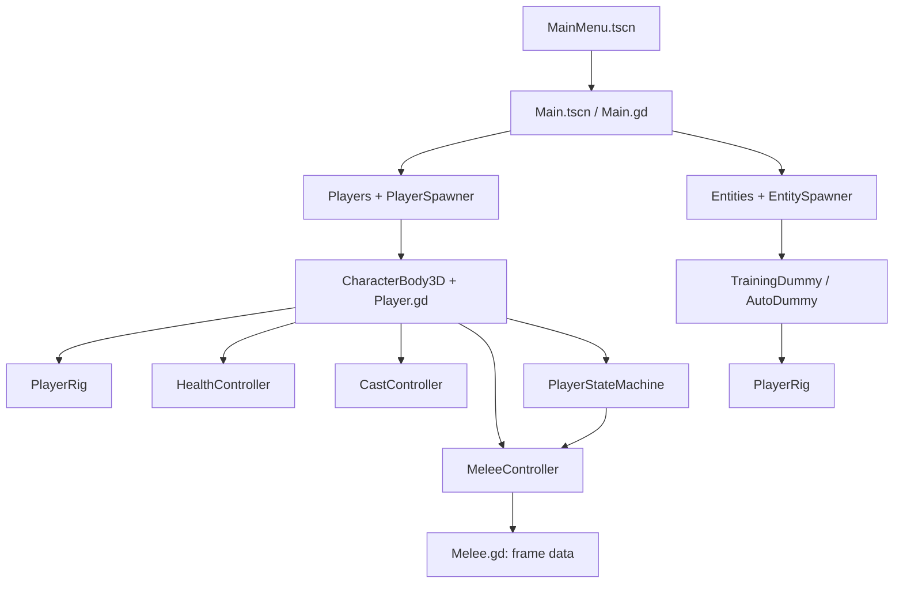
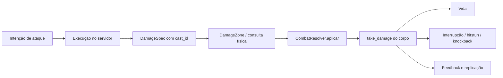
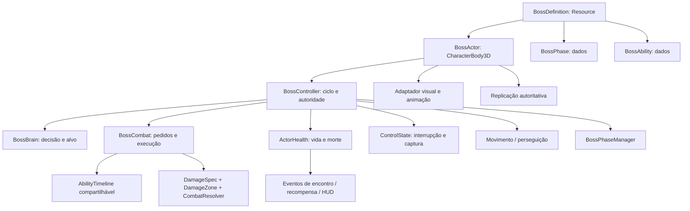
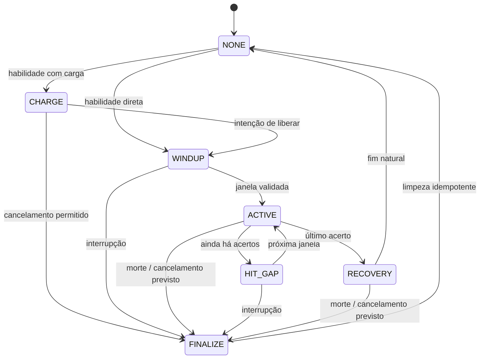
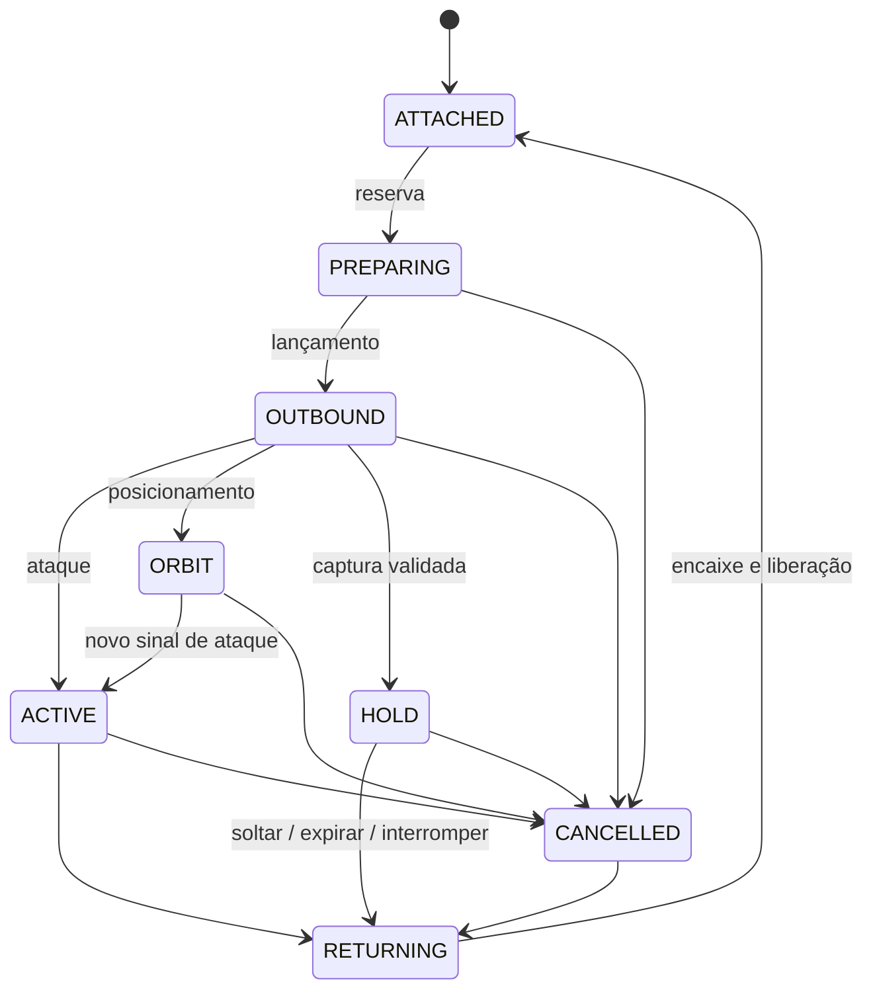
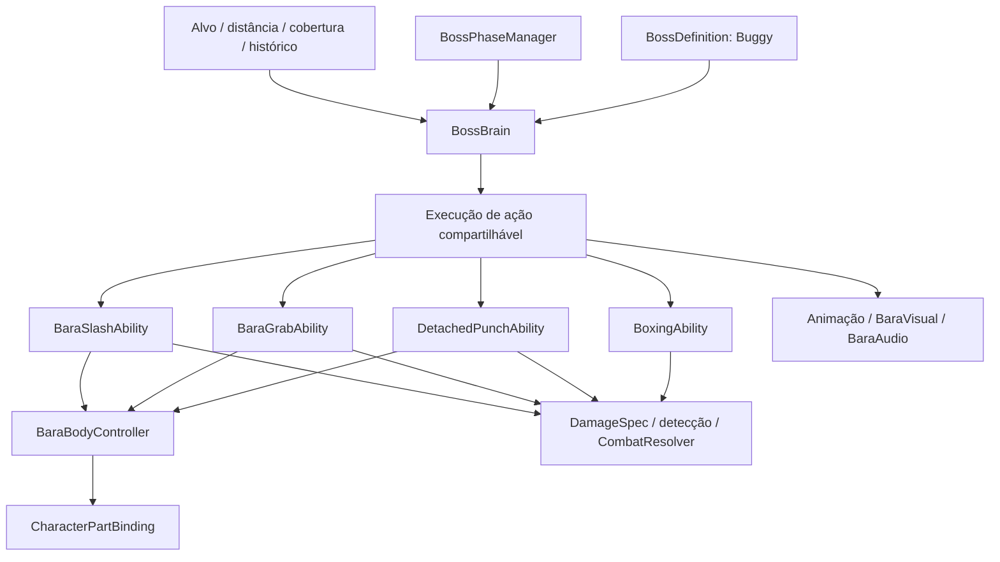

# Preparação do primeiro Boss — Buggy

> Estado de execução — 13/09/2026: base, combo, reação e corte já implementados; incremento 4 acrescenta a mão direita separável como finalizador. Ver [BOSS_BUGGY_DETACHED.md](BOSS_BUGGY_DETACHED.md) para comportamento, validação e pendências. As marcações de futuro abaixo preservam a ordem do planejamento original.
Data da auditoria: 2026-09-12. Projeto: Godot/GDScript, Skills One Piece.

**Escopo desta entrega:** importar e disponibilizar um visual temporário para Player e Dummy, preservar os visuais originais e documentar a arquitetura futura. O usuário escolheu manter **o modelo original como padrão**, com Buggy acessível por opção de teste. A proposta abaixo não afirma que o Boss, sua IA ou suas habilidades já estejam implementados.

## 1. Estado atual

A arena é um jogo PvP cliente-servidor. O corpo do jogador é simulado pelo peer proprietário; o servidor decide dano. Bonecos de treino são entidades simuladas pelo servidor. A base já usa composição para rig, vida, decisão de cast e combo, embora a execução de habilidades e várias regras continuem em `Player.gd`.

Não existe `CombatExecutor` neste checkout. A busca em scripts e cenas também não encontrou os estados literais `HIT_GAP` e `TETHERED`. A arquitetura deve partir dos componentes reais descritos na seção 3, sem criar uma segunda implementação presumindo que a classe citada no briefing já existe.

`Main.gd` mantém `ENEMIES_ENABLED = false`. O antigo `Enemy` permanece em `disabled/enemies/` e é um inimigo simples/domável; não há Boss real ativo. O Dummy possui reset de treino, que não deve virar regra de morte de Boss.

A auditoria inicial foi feita antes das alterações e apresentada pelo agente principal. Leituras estáticas confirmam estrutura e contratos; não provam comportamento visual ou multiplayer. O estado de validação da integração é registrado nas seções 5 e 21.

Referências persistentes consultadas: `docs/AGENTES.md`, `docs/ESTADO_ATUAL.md`, os trechos pertinentes de `docs/erros.md` e os arquivos de código relacionados abaixo. O baseline documentado em `ESTADO_ATUAL.md` é de **70 testes passando e 11 falhando**, na árvore com trabalho não commitado; não é resultado reexecutado nesta auditoria.

## 2. Arquivos analisados

| Arquivo | Funções/contratos relevantes | Implicação para o Boss |
|---|---|---|
| `project.godot`, `MainMenu.tscn`, `Main.tscn`, `Main.gd` | `_ready`, `_spawn_player_data`, `_spawn_entity_data`, `_make_entity_sync`, `_make_player_sync` | Entrada, composição de cena e replicação |
| `Player.gd` | `_ready`, `_setup_character_model`, `take_damage`, `_etapa_travamento`, `_net_cast`, `_do_server_cast` | Fachada atual que mistura integração, rede e regras específicas do jogador |
| `src/player/player_rig.gd` | `montar_em`, `montar`, `modelo`, `procedural`, `esqueletal`, `cabeca` | Fronteira do visual; preserva referências usadas por armas e efeitos |
| `src/entities/TrainingDummy.gd` | `_ready`, `_physics_process`, `take_damage`, `_fit_model`, `_reset` | Contrato do alvo de teste e suas regras específicas |
| `src/entities/AutoDummy.gd` | `_physics_process`, `_find_target`, `_attack`, `_recolor_model` | IA simples de treino; não é arquitetura de Boss |
| `src/player/health_controller.gd` | `sofrer_dano`, `regenerar`, `restaurar`, `empurrar`, `impulso_do_quadro` | Vida e impulso já separados, mas com regras de Player |
| `src/player/cast_controller.gd` | `comecar`, `carregando`, `suprimir`, `liberar_por_dano`, `abortar` | Decisão de habilidades e carga, acoplada aos campos do Player |
| `src/player/melee_controller.gd` | `pedir`, `fase`, `tempo_na_fase`, `cancelar_golpe` | Relógio, buffer e cancelamento do combo atual |
| `src/player/hsm/PlayerStateMachine.gd` e `CombatState*.gd` | `transition_to`, `enter`, `physics_update` | FSM do Player e leitura das fases do M1 |
| `src/combat/Melee.gd` | `startup`, `ativo`, `recuperacao`, `recuo`, `golpear`, `clipe` | Frame data, animação e criação de golpes existentes |
| `src/combat/contextual_melee.gd` | Variações direcionais, counter hit e uso de `DamageZone` | Referência para variações de ataque, sem impor controles à IA |
| `src/effects/DamageZone.gd` | `setup`, `_on_body`, `_varrer_caminho` | Hitbox reutilizável, orçamento e autoridade do dano |
| `src/combat/CombatResolver.gd` | `novo_cast`, `aplicar`, `_cobrar`, `encerrar` | Teto de dano por conjuração/alvo |
| `src/combat/DamageSpec.gd`, `src/combat/Balance.gd` | `para_cast`, `marcar`, tipos de dano por distribuição | Dados de balanceamento e identidade dos acertos |
| `src/mechanics/Knockback.gd` | `calcular`, `horizontal`, `vertical` | Cálculo vetorial independente do teclado |
| `src/mechanics/RecepcaoDeDano.gd` | `aplicar`, `tick`, `limpar`, `paralisar_com_animacao` | Recepção, pose e duração de controle |
| `src/match/Scoreboard.gd` | `register_hit`, `report_death`, `_peer_of` | Placar é orientado a peers/jogadores; ignora NPCs |
| `network/NetworkConfig.gd`, `ServerManager.gd`, `ClientManager.gd` | `SERVER_ID`, `DEFAULT_PORT`, hospedagem/entrada | Autoridade e isolamento dos testes de rede |
| `disabled/enemies/Enemy.gd` | `_is_authority`, `_physics_process`, `_ai` | Referência histórica, mantida desativada |

O catálogo específico da Bara Bara e dos assets/animações está nas seções 5 e 9–17. O inventário detalhado de combate também está em [BOSS_BUGGY_COMBAT_DESIGN.md](BOSS_BUGGY_COMBAT_DESIGN.md).

## 3. Arquitetura existente

### Cenas e composição

`project.godot` entra em `MainMenu.tscn`. A partida usa `Main.tscn`/`Main.gd`. O Player e os Dummies não possuem cenas `.tscn` próprias: o orquestrador cria `CharacterBody3D`, atribui o script e acrescenta um `MultiplayerSynchronizer` antes do spawn.



`PlayerRig` gerencia o modelo, mas preserva vários nós visuais como filhos diretos do corpo. Essa hierarquia é testada por `test_player_rig.gd`; introduzir arbitrariamente um novo pai `CharacterVisual` quebraria expectativas existentes. A troca temporária deve respeitar o contrato atual ou usar um adaptador com compatibilidade explícita.

### Acerto, vida e controle



A interface de dano existente é `take_damage(amount, attacker_pos, base_knockback, hitstun_duration)`. O nome de cada parâmetro varia entre atores; os quatro argumentos posicionais são o contrato comum. A hurtbox é hoje o próprio colisor do `CharacterBody3D`; não existe componente genérico `Hurtbox`, `Combat` ou `Interaction`.

`DamageZone` exclui o caster, evita dois acertos da mesma zona no mesmo corpo e só aplica dano no servidor. `DamageSpec` fornece identidade e orçamento compartilhado entre hitboxes irmãs. O teto limita dano, mas não interrompe automaticamente knockback e hitstun: o resolver ainda chama `take_damage` quando o orçamento restante é zero.

`HealthController` é `RefCounted`, não um nó. Ele mantém vida, energia, regeneração e impulso horizontal. `empurrar` lê teclado e orientação do Player para resistência ao knockback; portanto sua reutilização integral no Boss faria a IA depender do input do host.

### Estados: equivalência técnica

| Conceito solicitado | Implementação real | Recomendação |
|---|---|---|
| `NONE` | `Idle`/fase vazia em `MeleeController.fase()` | Ausência de habilidade em execução |
| `CHARGE` | `CastController.carregando()` e cargas específicas | Fase opcional comandada por intenção, sem ler teclas no núcleo |
| `WINDUP` | `AttackStartup` e `Melee.startup()` | Antecipação/compromisso até abrir hitbox |
| `ACTIVE` | `AttackActive` e janela de dano | Único intervalo que autoriza os acertos previstos |
| `HIT_GAP` | Não há estado genérico | Intervalo opcional entre janelas de uma habilidade multihit |
| `RECOVERY` | `AttackRecovery` e `MeleeController` | Recuperação punível e condições de cancelamento |
| `TETHERED` | Flags como `is_frozen`, `in_kurouzu`, `in_vortex` | Estado de controle independente da fase da habilidade |

Não converter a FSM do Player nesta tarefa. Uma futura `AbilityTimeline` pode centralizar a cronologia comum, extraída de forma incremental; durante migração, cada ataque terá **um único relógio proprietário**. Manter o relógio de `MeleeController` e adicionar outro contador concorrente reproduziria a divergência que a FSM atual buscou eliminar.

### Multiplayer

O Player usa autoridade do seu peer para posição. Vida é comunicada por `net_vida_do_servidor`; knockback chega ao dono por `net_apply_knockback`. A vida não pertence ao synchronizer do Player porque ele replica a partir do cliente proprietário.

As entidades de mundo usam `NetworkConfig.SERVER_ID`. Atualmente o sync dessas entidades transporta apenas `position` e `health`, sem orientação, fase de habilidade ou animação. Os RPCs atuais do Player permanecem no seu nó: movê-los para outro caminho é mudança de protocolo.

## 4. Problemas encontrados

Os itens abaixo são achados de inspeção ou riscos derivados dos contratos; não são alegação de regressão causada pela integração do Buggy.

| Achado | Evidência | Consequência / tratamento |
|---|---|---|
| `CombatExecutor` não existe | Busca global em scripts/cenas; componentes reais na seção 3 | Corrigir a premissa do planejamento; não inventar reutilização |
| Vida, input e impulso ainda se misturam | `HealthController.empurrar` chama `Input.is_key_pressed` | Extrair contexto de resistência antes de compartilhar com IA |
| Dummy tem fit específico da base | `TrainingDummy._fit_model` usa escala Z multiplicada por `1.85` | Modelo importado precisa fit próprio uniforme; não herdar deformação |
| AutoDummy repinta todo o modelo | `_recolor_model` substitui `material_override` | Preview deve preservar os materiais do asset |
| Controle depende de metadados sem posse | Grabs Gura/Bomu/Mink e timer de `DamageZone.paralisa` escrevem `is_frozen` | Timer antigo pode soltar captura nova; contrato com token e origem é necessário |
| Grabs atribuem posição diretamente | `_process_gura_rush`, `_process_bomu_rush`, `_process_mink_hold` | Escrita na réplica do Player pode perder para a autoridade do dono |
| Hitstun remoto perde duração específica | `net_vida_do_servidor` recebe vida/dano e chama feedback com duração padrão | Testar golpes de Boss em dois peers; futura mensagem de impacto deve transportar duração |
| Sync de NPC só carrega posição/vida | `Main._make_entity_sync` | Boss exige orientação, ação, fase, tempos e snapshot tardio |
| Orçamento é consumido antes da recepção | `CombatResolver.aplicar` cobra e depois chama `take_damage` | Ao criar resistências, decidir se rejeição consome orçamento; retorno atual não mede HP efetivamente perdido |
| Tipo de dano não distingue corte | Assinatura de `take_damage` e `DamageSpec` | Resistência Bara a cortes requer extensão compatível futura |
| Forma customizada não tem sweep volumétrico geral | `DamageZone._varrer_caminho` usa fallback por raio | Cortes finos rápidos precisam consulta apropriada e testes rasantes |
| Recompensa e morte são específicas de Player | `Scoreboard._peer_of`, `register_hit`, `report_death` | Boss não deve receber peer falso nem entrar no placar como jogador |
| Corpo de treino reseta sozinho | `TrainingDummy._reset` e timeout de 30 s | Não herdar Dummy para implementar morte/recompensa de Boss |

## 5. Integração do modelo

**Implementado e testável por opção**, mantendo o modelo original no lançamento normal. Execute `./jogar_buggy.sh` na raiz e entre em Singleplayer. TrainingDummy pode ser ligado por F1 e AutoDummy por F2, os controles existentes. Para reverter, feche a sessão e abra `./jogar.sh`. A variável `SOP_TEST_CHARACTER_VISUAL` só é exportada no processo de teste; não salva customização nem troca fruta/identidade.

| Item | Resultado confirmado |
|---|---|
| Fonte | `/home/gabriel-bitti/Downloads/buggyBoss.glb` — extensão real `.glb`, glTF 2 binário |
| Destino | `assets/models/bosses/buggy/buggyBoss.glb` + importador nativo `.glb.import` |
| Integridade | Original e cópia SHA-256 `e05a9aa859a46ee9d89773ff995a1b2be90c74e6d300c3de51a5bd953ce4eabc`; nenhuma conversão |
| Geometria | 71.590.048 bytes; 56 nós; 13 malhas; 976.226 vértices; 1.881.078 triângulos; dados em `art_src/validation/buggy/asset_audit.json` |
| Rig | 41 ossos, nenhum clipe embarcado; mapeamento explícito de 13 papéis no recurso |
| Materiais | 13 materiais/texturas PBR preservados; sem pintura cinza da customização ou vermelha do AutoDummy |
| Escala | Fonte com altura 0,9787592 m; fator uniforme 1,532553; altura de repouso 1,500000 m em Player e Dummy |
| Pivô/pés | Base geométrica local Y=-0,800000, alinhada ao fundo do colisor; não alongar Z no Dummy |
| Frente | Giro Y=180° no recurso, confirmado por captura frontal; convenção do jogo -Z e direita anatômica +X preservadas |
| Mãos | `BoneAttachment3D` nos ossos `L_Hand/R_Hand`, sockets `Grip_L/R` e `Weapon_R`; erro medido de posição menor que 0,001 m na pose final |
| Câmera e colisão | Mesma câmera e BoxShape3D do ator; primeira pessoa oculta o wrapper, terceira pessoa restaura; nenhuma colisão adicionada ao visual |

O seletor é `src/characters/CharacterVisualDefinition.gd`; dados do Buggy ficam em `buggy_boss_visual.tres`. `PlayerRig` consulta a opção e valida cena/altura/mapa antes da remontagem. Recurso inválido retorna ao construtor original. `CharacterBuilder`, os arquivos antigos de Buggy e o modelo base foram preservados. Não há condição por identidade de Boss no Player.

O mapa usa `Waist`, `NeckTwist01`, `Head`, `L/R_Upperarm`, `L/R_Forearm`, `L/R_Thigh`, `L/R_Calf`, `L/R_Foot`. O argumento opcional de `SkeletonDriver.setup` conserva os aliases anteriores para todos os modelos sem override. O Dummy usa o mesmo fit e recebe atualização visual procedural, sem mover a autoridade da física. O AutoDummy também consegue disparar seu clipe existente no rig skinned; isto continua sendo treino, não Boss.

**Evidência visual na engine:** [câmera de jogo](../art_src/validation/buggy/buggy_gameplay.png), [Player e Dummy](../art_src/validation/buggy/buggy_pair.png), [modelo original na mesma composição](../art_src/validation/buggy/original_pair.png), [walk](../art_src/validation/buggy/buggy_walk.png), [M1](../art_src/validation/buggy/buggy_punch.png), [pose de salto](../art_src/validation/buggy/buggy_jump_pose.png), [pose de dano](../art_src/validation/buggy/buggy_damage_pose.png). Capturas em Godot 4.6.3 Forward+, Vulkan, RTX 3050 6GB Laptop, 1280×720. As poses isoladas de salto/dano validam deformação visual; não são um playtest completo da movimentação.

As mãos do arquivo **já são geometricamente fechadas**, confirmado no close. Ausência de dedos articulados impede abrir/fechar dinamicamente por animação de ossos; não impede usar os punhos fechados atuais. A guarda específica de boxe, contato preciso do jab/hook/uppercut e empunhadura de todas as armas permanecem trabalhos futuros. Os clipes existentes se movem, mas isso não os torna o boxe autorado do Buggy.

As 13 malhas são segmentos `tripo_part_*`, não partes anatômicas independentes: roupa das pernas e pesos compartilhados exigem preparação antes da separação real. A densidade original foi preservada; não foi medido orçamento de FPS/memória em encontro completo. Os LODs automáticos do importador não substituem essa medição. Procedência e limitações estão em `assets/models/bosses/buggy/README.md`.

**Multiplayer do preview:** a escolha é local ao processo. Para comparar dois peers com a mesma aparência, inicie ambos com a opção. Ela não acrescenta um ID visual ao protocolo de spawn. A arquitetura futura do Boss deverá replicar a definição e o snapshot autoritativo, conforme seção 6.


A sonda de rede desta entrega valida dano/autoridade, não sincronização completa de animação do AutoDummy. O sync atual de entidades só transmite posição/vida; clientes não recebem sua velocidade/clipe de ataque como snapshot. Isso permanece uma limitação do boneco de treino e deve ser resolvido no contrato de apresentação do futuro Boss, sem copiar essa limitação para ele.

## 6. Arquitetura genérica de Boss

### Composição proposta

Criar futuramente um `BossActor` próprio, derivado de `CharacterBody3D`. O ator expõe o contrato público de dano e compõe os sistemas abaixo; não herda `Player`, `TrainingDummy` ou `AutoDummy`.



Estes são contratos propostos, não obrigação de criar imediatamente um arquivo para cada caixa. Implementar uma divisão quando a primeira mecânica justificar o estado e a responsabilidade; evitar abstrações vazias nesta tarefa de importação e planejamento.

| Módulo proposto | Possui | Recebe / publica | Não deve possuir |
|---|---|---|---|
| `BossDefinition` | ID estável, referência visual, vida, movimento, habilidades e fases | Dados imutáveis do personagem | Lógica condicional por nome de Boss |
| `BossActor` / `BossController` | Ciclo de vida, composição, ordem de física | `take_damage`, spawn, reset do encontro, eventos | Todas as skills dentro do mesmo script |
| `ActorHealth` | HP, limite, aplicação/resultado de dano, morte uma vez | Eventos de mudança de vida e morte | Teclado, RPC, câmera, respawn do Player |
| `ControlState` | Hitstun, stagger, impulso, capturas e prioridades | Contexto de resistência, tokens, interrupções | Estado visual como fonte de verdade |
| `BossBrain` | Alvo e memória curta de decisão | Intenção de movimento/ataque | Alteração direta de HP ou spawn de hitboxes |
| `BossCombat` | Habilidade atual, cooldowns, cast ID e execução | Aceita/rejeita intenções; emite fases de ataque | Leitura de teclas e busca de HUD |
| `AbilityTimeline` | Relógio único e janelas de habilidade | Eventos de windup/active/gap/recovery/finalização | Segundo relógio sombreando M1 existente |
| `BossPhaseManager` | Fase do encontro e transições validadas | HP/eventos; conjunto de habilidades permitido | Reset silencioso de HP/cooldowns |
| Adaptador visual | Rig, materiais, sockets e animação | Eventos e progresso de apresentação | Decidir colisão ou recompensa |

### Identidade, facções e autoridade

O servidor atribui `actor_id` e `encounter_id` estáveis; `actor_id` não é peer ID e não pode ser apenas `get_instance_id()`, que varia entre máquinas. Cada ataque tem sequência de execução e `cast_id` para orçamento local do resolver. Os eventos de rede referenciam ator, encontro e sequência; não dependem de nomes visuais de nós aleatórios.

Boss participa inicialmente do grupo `enemy`, permitindo que as consultas existentes o encontrem, mas não do grupo `player`. Antes de adicionar aliados/outros NPCs, um predicado central de facção deverá filtrar alvos sem espalhar `if boss == buggy` ou assumir que todo objeto com `take_damage` é inimigo.

Simulação, IA, escolha de alvo, dano, fases, morte e recompensa são do servidor. Os clientes reproduzem animação/VFX a partir de eventos aprovados e snapshots. Componentes recebem explicitamente a decisão de autoridade do ator; não inferem autoridade em nós criados depois de `_ready`.

O snapshot mínimo inclui definição visual, posição, orientação, HP máximo/atual, fase do encontro, estado de controle relevante, habilidade/execução atual, instante de início e morte. Entrada tardia deve reconstruir o estado atual sem repetir acertos ou recompensa.

### Recompensa e encerramento

Boss emite `died(encounter_id, actor_id, contributors)` uma vez no servidor. Um serviço do encontro converte isso em recompensa/loot e evento de UI; `Scoreboard` PvP continua recebendo apenas seus eventos conhecidos. A chave de idempotência da recompensa inclui encontro e ator. Política de contribuição, destinatários e persistência é uma decisão futura de produto, não inferida da última hitbox que tocou o corpo.

Despawn, morte, retorno ao ponto inicial e reinício do encontro são eventos distintos. Retorno por perda de alvo não deve conceder loot nem contar como morte. A barra de vida observa eventos/snapshot; não calcula HP localmente.

## 7. Arquitetura específica do Buggy

`BuggyDefinition` referencia a aparência, o perfil de boxe, as habilidades Bara Bara e as três fases descritas na seção 13. O comportamento específico vive em dados e implementações de habilidade modulares, sem ramificações por nome do Boss em Player, Dummy ou resolver.

`BuggyBrain` pode especializar uma política do `BossBrain` para alternar curta distância, reposicionamento e ataques de partes/cortes. O cérebro consulta alcance, linha de visão, espaço seguro, último movimento, compromisso de ataque e disponibilidade; ele não lê o teclado do jogador nem cria dano fora do servidor.

Partes destacadas devem ser futuras instâncias de `DetachedBodyPart`, cada uma com `owner_actor_id`, `part_id`, transform, trajetória, velocidade, alvo opcional, estado e vínculo à execução. Estados de parte sugeridos: `ATTACHED`, `OUTBOUND`, `HOLDING`, `RETURNING`, `DISABLED`. É um domínio diferente da fase de ataque e do controle do personagem.

O contrato visual futuro deve diferenciar cabeça, torso, braços, mãos e pernas. O rig atual usa papéis como `UpperArm_R`/`ForeArm_R`, que não significam malhas destacáveis; renomear bones não separa geometria. Destacar braço não torna automaticamente o torso imune nem cria hurtbox adicional. Essas decisões dependem da implementação da fruta e da preparação do asset.

### Contrato de execução e cancelamento



O diagrama é proposto; `FINALIZE` pode ser rotina, sem virar estado público. `TETHERED` não aparece porque pertence ao controle do alvo: o captor pode manter uma captura enquanto executa um ataque.

Cada execução captura um token; callbacks só agem se ainda forem donos da execução. `finish(reason)` é idempotente e desativa hitboxes, encerra orçamento, libera capturas/partes de sua propriedade, cancela callbacks e remove travas próprias. Deve funcionar para fim natural, interrupção, morte, despawn, alvo inválido, desconexão e mudança de fase.

A mudança de fase invalida a decisão seguinte da IA e respeita uma fronteira segura da ação atual, salvo interrupção explicitamente definida. Cooldown, consumo de recurso e reembolso pertencem aos dados da habilidade; não podem ser resetados implicitamente pela animação ou pela troca de fase.

Capturas exigem confirmação autoritativa de alcance/alvo e token de posse. A vítima Player recebe a trava no peer que simula seu corpo, com validação do servidor; mover apenas sua réplica no host não é suficiente. Uma habilidade só pode liberar a captura que criou. A tolerância a interrupção/stagger do Boss é dado por habilidade/fase, não imunidade permanente genérica.

## 8. Sistema de Boxe

Buggy mantém punhos fechados, queixo protegido, base estável e mão oposta na
guarda. Jab parte do ombro com passo curto; cross usa quadril; hook descreve arco
lateral; uppercut combina flexão e extensão das pernas; body blow abaixa centro
de massa. A esquiva desloca tronco e base antes do contra-ataque.

`BoxingStyle` reúne dados; `BoxingMoveDefinition` descreve pose/clipe, lado,
startup/ativo/recuperação, deslocamento permitido, shape e efeito de impacto;
`BoxingAbility` executa. A IA apenas solicita o movimento. A posição de contato
vem do binding do punho, não de offset fixo no chão.

| Combo proposto | Função | Saída/punição |
|---|---|---|
| Jab → Jab → Cross | Ensinar ritmo e pressão curta | Cross compromete direção; erro deixa recuperação. |
| Jab → Hook | Pressionar movimento lateral já observado | Recuar além do arco antes do hook. |
| Body Blow → Uppercut | Preparação baixa e finalizador | Intervalo e movimento lateral oferecem escape. |
| Slip → Counter Cross | Contra-atacar ataque observado | Reação possui atraso; sem ler botão futuro. |
| Jab → Detached Jab → Side Punch | Estender pressão quando alvo recua | Cada nova origem é anunciada; combo exige partes livres. |
| Detached Jab → Diagonal Slash | Combinar níveis na fase 3 | Novo telegraph e janela entre ameaças. |

Não copiar automaticamente o hitstun do combo PvP. O briefing histórico registra
vantagem que mantém encaixe; Boss precisa de limite de sequência, recuperação
punível e janelas de escape medidas. Dano alto não substitui identidade de golpe.

Dados próprios do Boss usam `src/combat/boxing/`; não modificar o combo atual do Player, que contém chute. O GLB observado já tem mãos geometricamente fechadas, mas não dedos articulados: a guarda e a precisão do boxe ainda exigem autoria e playtest.

## 9. Bara Bara atual

Inventário conferido no código, incluindo caminhos legados e testes. O código atual foi preservado.

| Responsabilidade | Arquivo e ponto de entrada | Evidência |
|---|---|---|
| Catálogo e nomes da barra | `SkillSystem.gd`, entrada `bara_bara` | Z Dismantle, X Buggy Ball, C Cleave, V Shrine. |
| Dano | `src/combat/Balance.gd`, `FRUTAS.bara_bara` | Z 92, X 168, C 80 × 5, V 96 × 8. Tetos dos slots C/V: 384/768. |
| Identidade da conjuração | `src/combat/DamageSpec.gd`, `para_cast`/`marcar`; `CombatResolver.gd`, `novo_cast`/`aplicar` | Hitboxes irmãs compartilham orçamento por alvo. |
| Despacho | `Player.gd`, `_fire_skill`, chamada `BaraFX.cast` | Obtém `Balance.novo(fid, slot)` e envia a spec ao efeito. |
| Entrada sustentada | `src/player/cast_controller.gd`, ramo C de Bara | Press inicia hold, release limpa; usa `bara_cleave_active`. |
| Recarga especial | `cast_controller.gd`, ramo V; `BaraDomainController._exit_tree` | Evita domínio duplicado; cooldown V começa ao terminar. |
| Transporte hold | `Player.gd`, `pedir_iniciar_hold`, `_net_start_hold`, `pedir_cancelar_hold`, `_net_cancel_hold` | Meta específica Bara participa do protocolo do Player. |
| Passiva declarada | `FruitPassiveSystem.gd`, `get_all_passives`/`equip_fruit` | Texto promete 35% de esquiva de dano cortante/frontal; dados só contêm velocidade/pulo. |
| Passiva aplicada | `Player.gd`, leitura de `speed_mod` ao equipar | Bara tem velocidade ×1,05, pulo ×1. Não há esquiva correspondente. |
| Z | `src/effects/BaraFX.gd`, `_bara_corte` | Projétil `DamageZone`, torus achatado, partículas, flash e `AudioFX.hurt`. |
| X | `BaraFX.gd`, `_bara_buggy_ball` e callback `explode_fn` | Flecha/esfera de fogo; explosão visual em contato ou expiração. |
| C | `BaraFX.gd`, `_bara_area_cortante`, classe interna `BaraCleaveController` | Nó filho do caster, consulta esférica e dano pelo resolver. |
| V | `BaraFX.gd`, `_bara_dominio`, classe interna `BaraDomainController` | Nó no mundo de skills, santuário, alteração de ambiente e dano por grupos. |
| Rede visual V | `BaraDomainController._net_spawn_single_slash` | RPC `any_peer`, `call_local`, `reliable`; apresentação por alvo atingido. |
| Áudio/VFX compartilhados | `AudioFX.gd`, `src/effects/FxUtil.gd`, `src/fx/ScreenFX.gd` | Bara chama áudio genérico de dano, partículas/grãos/gradientes e tenta efeitos de tela. Não há `BaraAudio` dedicado. |
| Associação ao personagem legado | `Player.gd`, `_apply_character_from_fruit` | `bara_bara` seleciona `buggy`; não é uma arquitetura de Boss. |
| Construção visual antiga | `CharacterBuilder.gd`, `build_character`/`_build_buggy_animations`; `VoxelMeshes.gd`, `build_buggy` | Carregamento legado e fallback procedural. |
| Assets antigos | `assets/models/buggy.scn`, `buggy.glb`, `buggy.geo.json`, `buggy.png` e importações | Diferentes do asset novo `buggyBoss`; preservar. |
| Animação cosmética de separação | `CharacterBuilder._build_buggy_animations` | Fallback voxel desloca cabeça em jump/damage, braços em kill e peças em death. Não cria partes/hitboxes independentes. Caminho GLB usa outra animação. |
| Rig | `src/player/player_rig.gd`, ramo `SkinPivot` do Buggy; `src/anim/BodyScanner.gd`, `RigDetalhado.gd` | Compatibilidade do Buggy legado; papéis não asseguram mãos/segmentos destacáveis. |
| Customização e menu | `src/customizacao/Racas.gd`, `Visual.gd`; `src/ui/CharacterMenu.gd`, `CustomizacaoMenu.gd` | Preset `palhaco`, roupa, maquiagem e personagem Buggy; são aparência, não poderes. |
| Fruta no mundo | `TreeAndFruitGenerator.gd`, entrada `bara_bara` | Registro da fruta no gerador, sem execução de combate. |

Documentação relacionada: `docs/frutas/bara_bara.md`, `frutas/README.md`,
`AUDITORIA_FRUTAS.md`, `PLANO_FRUTAS.md`, `DIRECOES.md`,
`LIMITE_DE_TAMANHO.md`, `LISTA_DE_CORRECOES.md`,
`historico/MUDANCAS_2026-08-21.md` e `historico/MUDANCAS_2026-08-22.md`.
Referências históricas a nome de fruta inicial, elenco e resultados 4/4 não
comprovam o comportamento da árvore atual.

Sondas/testes com referências relevantes: `tools/dev_tests/test_buggy.gd`
(apenas constrói e imprime), `test_balance.gd`, `test_frutas.gd`,
`test_segurar_ataque.gd`, `test_elenco_trancado.gd`, `test_base_v2.gd`,
`test_initial_fruit.gd`, `checar_compilacao.gd`, `net_sweep_host_probe.gd`,
`net_sweep_client_probe.gd`, `net_dano_host_probe.gd`,
`net_dano_client_probe.gd`, `net_mp_host_probe.gd`, `net_mp_client_probe.gd`,
`medir_rig_detalhado.gd`, `medir_lados.gd` e `medir_customizacao.gd`.
`gravar_frutas.gd` exclui Bara; o sweep documenta a preparação de hold necessária
para C e a ausência deliberada de DamageZone em V.

### Comportamento legado

| Slot | Física e duração | Dano/controle | Dependência |
|---|---|---|---|
| Z | 45 m/s, 0,6 s, raio 1,2 m; trajetória nominal 27 m | 92, KB 18, derruba 1,2 s | DamageZone e caster excluído. |
| X | 25 m/s, raio 0,6 m; setup 1,5 s, tween encerra em 18/25 = 0,72 s | 168, KB 18, derruba 1,5 s; explosão não causa AoE | Callback de colisão/expiração. |
| C | Hold até 7 s; esfera 12 m; tick nominal 1,4 s | 80 por hit, teto 384; lock 0,5 s e hitstun 0,1 s | CharacterBody3D, meta de hold, consulta física, resolver. |
| V | 30 s; esfera lógica 40 m; tick 3,5 s | 96 por hit, oito nominais, teto 768, hitstun 0,8 s | Caster, câmera/ambiente, grupos player/enemy, resolver. |

C e V executam dano somente no servidor. O centro de V deriva da posição do
santuário atrás do caster, encontrada por raycast; não é uma hurtbox móvel.
Nenhum desses quatro golpes movimenta um membro real do rig como parte da skill.
As separações cosméticas de `CharacterBuilder` não contradizem esse ponto.

### Problemas e limites

| Achado | Status e evidência | Consequência/encaminhamento |
|---|---|---|
| Identidade Dismantle/Cleave/Shrine | Confirmado em nomes e geometria | Preservar legado para comparação; nova Bara usa separação corporal como causa. |
| Esquiva 35% ausente | Confirmado por contrato e leitura; já registrado na lista de correções | Não prometer passiva funcional. Definir separação defensiva determinística no futuro, com sinal e recarga. |
| C varia número de hits com delta | Inspeção + simulação aritmética da ordem de `_process`: 30/60 FPS deram 5 hits; 120 FPS deu 4 | Encerramento acontece antes do último tick e sobra é descartada. 320 versus 384 após teto. Ainda não reproduzido executando o controlador no Godot. |
| V não restaura ambiente | Confirmado: `_ready` escreve cores, `_exit_tree` não restaura | Usar modificador temporário com posse/restauração e composição entre efeitos. |
| V pressupõe câmera | Confirmado acesso sem null check a `get_camera_3d()` | Servidor sem câmera precisa executar combate sem apresentação. Falha nesse cenário ainda requer sonda. |
| C/V não registram crédito como DamageZone | Confirmado: resolver cobra/chama take_damage; register_hit está em DamageZone | Compartilhar serviço de impacto/crédito; testar kill/recompensa. |
| C/V ignoram paredes | Confirmado: consulta de esfera/grupo sem LOS | Redesenho exige trajetória/cobertura e janela de evasão. |
| RPC visual V aceita qualquer peer | Confirmado decorator sem validação no método | Restringir origem dos eventos; dano já é servidor. Não afirmar exploração reproduzida. |
| Z/X não ligam is_projectile | Confirmado ausência da flag nas duas funções | Não entram no ramo de deflexão/clash de projétil; testar antes de alterar comportamento legado. |
| Explosão X só visual | Confirmado callback sem DamageZone nova | É limite do comportamento atual, não decisão automática de adicionar dano. |
| Origem X soma +2,2 m | Confirmado +1,2 no dispatch e +1,0 interno | Não ancora na mão. Inadequação depende da altura do modelo e precisa avaliação visual. |
| ScreenFX consultado como singleton nativo | Confirmado `Engine.has_singleton`; project.godot declara autoload | Resolver nó/serviço correto para os flashes internos. |
| BaraFX agrega responsabilidades | Confirmado arquivo com execução, alvo, arte, RPC, cooldown e classes internas | Extrair por comportamento quando implementar o novo kit; não apenas dividir por tamanho. |

Hipóteses que precisam de reprodução antes de corrigir: explosão X divergente
entre peers; truncamento ou alvos duplicados na consulta C em cena densa;
cancelamento de V na morte/troca; controle aplicado durante invulnerabilidade;
interferência de múltiplos domínios no ambiente. Não foram executados playtest,
avaliação visual ou teste multiplayer nesta frente documental.

Reprodução da simulação aritmética: iniciar `elapsed=tick=0`; somar `1/fps` a
elapsed; encerrar quando `elapsed>=7`; somar ao tick; se `tick>=1.4`, incrementar
hits e zerar tick. Em cada FPS executar até o encerramento. A simulação evidencia
a fragilidade do limite, não substitui teste do controlador real.

### Reaproveitamento

| Sistema | Reuso | Limite |
|---|---|---|
| Balance/DamageSpec/CombatResolver | Um orçamento por conjuração/alvo; reserva de clímax quando necessária | Não usar specs avulsas sem teto no Boss final. |
| DamageZone/Knockback | Dano servidor, contato, exclusão do dono, varredura esférica e empurrão | Formas não esféricas têm fallback por raio; não assumir CCD de largura arbitrária. |
| Melee.gd | Frame data e execução de contato | Combo atual inclui chute; não mudar Player para atender o Boss. |
| MeleePoses.gd | Guarda, apoio, override após clipe bakeado | Override deve chegar ao driver; caminho aditivo pode ser pulado durante clipe. |
| FightingStyles.gd | Registro do estilo boxe e contratos | `_cast_boxe` ignora variant: as quatro skills viram o mesmo projétil a 30 m/s. Não é boxe concluído. |
| GomuArm.gd | Exemplo de ocultar membro e EXTEND/HOLD/RETRACT | Malha de borracha/caixas e manipulação do Player não são apresentação Bara final. |
| SwordSweep.gd | Cápsulas/esferas entre amostras, contato e cobertura | Curvatura entre amostras continua aproximada. |
| OpeController.gd | Exemplo modular de validar, executar, cancelar e apresentar eventos | Não transportar dependências de ROOM ou Player para Boss. |
| FxUtil/AudioFX | Criação e limpeza de efeitos; referência de contrato de áudio | Áudio próprio de telegraph ainda precisa autoria. |

## 10. Nova Bara Bara

### Nível 1 — Separação corporal

Separar braço, mão, cabeça ou perna; controlar trajetória; alcançar, atacar,
agarrar, reposicionar e retornar. Uma parte só ocupa um estado/ação por vez.
Separação defensiva futura deve ser anunciada e ter cooldown; não implementar
uma chance aleatória de ignorar golpe apenas para cumprir a descrição antiga.

### Nível 2 — Ofensiva com partes

Jab prolongado pelo antebraço; soco lateral; pinça de dois membros; partes em
órbita; sequência alternada e reposicionamento surpresa com sinal perceptível.
O inventário físico limita simultaneidade. “Múltiplos punhos” inicialmente usa
os dois punhos em sequência; rastros/afterimages não têm dano. Mais partes
ativas exigem asset e regra definidos, sem criar cópias corpóreas ilimitadas.

### Nível 3 — Cortes de separação

Proposta mecânica: seções finas do próprio corpo se separam, alinham e são
impulsionadas; sua passagem projeta uma trajetória cortante. O jogador vê a
origem corporal preparar o plano e observa o reagrupamento. A ação tem percurso
finito; não materializa acerto automaticamente dentro do alvo.

É uma interpretação de gameplay própria da Bara, não afirmação de cânone. Usar
somente a ideia abstrata de corte à distância da referência do pedido. Excluir
do novo kit nomes Dismantle/Cleave/Shrine, santuário e domínio de acerto inevitável.
O código antigo permanece disponível durante a migração.

### Partes independentes

`CharacterPartBinding` liga Head/Torso/LeftArm/RightArm/LeftHand/RightHand/
LeftLeg/RightLeg a nós, ossos, sockets e superfícies existentes. Ausência de uma
capacidade é explícita. Socket da mão não prova que a malha pode se separar.

`DetachedBodyPart` contém part_id, dono, attachment, transform, trajetória,
velocidade, alvo, estado, shape de contato, identidade da ação e política de
retorno. `BaraBodyController` reserva/libera partes e impede duas habilidades de
usar a mesma peça. A hurtbox da parte é decisão explícita: inicialmente pode
redirecionar dano ao Health do Boss, deduplicando por entidade, em vez de criar
vida extra acidental. Não considerar essa política já implementada.



Morte, despawn, troca de visual, desconexão e cancelamento devem restaurar
visibilidade e liberar reservas mesmo sem terminar animação. Interromper grab
solta ambos os atores e todas as travas. Captura valida servidor, alcance,
cobertura, estado do alvo e capacidade de controle; não teleporta alvo através
de parede. Relação de captura usa token, duração máxima e cancelamento idempotente.

Não reparentear ossos do Skeleton3D para arrancar malha skinned. Preparar
superfícies/segmentos e tampas de separação no asset ou gerar recurso derivado
reproduzível. Se o novo modelo não suportar isso, documentar a preparação
artística pendente e preservar teste visual do corpo inteiro.

### Módulos propostos

Brain escolhe intenção; executor controla compromisso temporal; habilidade
executa uma ação; componentes de partes, dano e visual fornecem serviços. A
definição do Boss referencia dados específicos. Não distribuir condições
`if boss == buggy` por Player, dano, navegação ou HUD.



Mapeamento conceitual dos estados pedidos: NONE = livre; CHARGE = carga
opcional; WINDUP = preparação/telegraph; ACTIVE = contato; HIT_GAP = intervalo
explícito entre impactos; RECOVERY = recuperação; TETHERED = relação temporária
de captura. No código presente, startup/active/recovery já existem no HSM do
Player. O nome e a extração da execução genérica devem seguir a proposta da
auditoria de arquitetura; este documento não cria um segundo sistema inteiro.

## 11. Sistema de cortes

`BaraSlashDefinition` descreve: origem/parte, direção, orientação do plano,
largura, espessura, alcance, velocidade, windup, momento de compromisso da mira,
ativo, recuperação, quantidade, intervalo, orçamento de dano, knockback,
hitstun, política de parede, interrupção e apresentação.

`BaraSlashAbility` executa um evento; `BaraSlashPattern` fornece sequência de
eventos. Um padrão compartilha cast_id e teto quando constitui uma habilidade.
Para repetir acerto deliberadamente, usar também índice de evento: deduplicar
por `(ação, evento, entidade_alvo)`. Várias hurtboxes do mesmo corpo não contam
como vários alvos. Padrões diferentes nunca compartilham spec-molde mutável.

| Variante | Geometria/ritmo | Contrajogo |
|---|---|---|
| Horizontal | Faixa no plano anunciado | Sair perpendicularmente do percurso. |
| Vertical | Faixa estreita vertical | Deslocamento lateral. |
| Diagonal | Plano inclinado visível na preparação | Ler lado/ângulo e sair da faixa. |
| Sucessivos | Eventos com intervalo e compromisso próprios | Reposicionar no intervalo. |
| Cruzados | Duas linhas em ordem | Primeiro corte não elimina todas as saídas do segundo. |
| Circular | Anel/setores de passagem | Setor aberto ou intervalo atravessável, sem esfera instantânea. |
| Concentrado | Mais estreito e longo, preparação maior | Punição pelo desvio após compromisso. |
| Área de cortes | Faixas sucessivas com corredores | Rota de saída preservada durante sequência. |

**CCD e largura:** varrer volume entre posições anteriores/atuais no servidor.
Para largura variável, usar amostras esféricas/cápsulas distribuídas pela frente
ou forma varrida apropriada; validar lacunas entre amostras e rotações. O
fallback de `DamageZone` para forma customizada usa raio de centro e não prova
a largura entre ticks. `SwordSweep` é referência reutilizável, não garantia
automática para uma lâmina de qualquer tamanho. Parar/recortar contra cenário
conforme definição; nunca atravessar parede por omissão da consulta.

**Janela de evasão:** medir aviso perceptível até primeiro contato, incluindo
tempo de voo, câmera, atraso de rede e deslocamento necessário para sair da
largura. Comprometer mira antes do impacto e limitar tracking; não retargetear
instantaneamente após o jogador já reagir. Ataques quase invisíveis continuam
tendo origem, som, plano de preparação e tempo de reação. Se uma variante não
deixa saída demonstrável no playtest, ajustar largura/cadência/antecipação.

## 12. IA

Proposta inicial: curta até 3 m; média 3–12 m; longa 12–30 m; histerese de 0,8 m
nas fronteiras. Medir alcance a partir de corpo/hurtbox e contatos reais antes
de fixar valores. Distância acima do alcance prioriza aproximação segura.

| Zona | Prioridades |
|---|---|
| Curta | Boxe, grab, hook/uppercut; estender jab se alvo recuar. |
| Média | Punhos destacados, flanco anunciado, perseguição; corte único somente fase 3. |
| Longa | Aproximação/reposicionamento nas fases 1–2; cortes/padrões na fase 3. |

Pipeline de decisão: observar alvo elegível → filtrar ações por fase,
distância, ângulo, cooldown, partes livres, terreno e cobertura → pontuar
oportunidade de combo e ação anterior → escolher maior pontuação com desempate
estável por id → registrar motivo e comprometer ação. Penalizar repetição e
manter histórico curto. Brain roda no servidor; clientes apresentam decisão.

Estado observado do jogador pode informar oportunidade (recuperação, posição,
direção de movimento); não consultar input futuro. Reação tem intervalo
configurável. Enquanto windup/active comprometido, Brain não substitui ação a
cada frame. Reavaliar somente em janelas de cancelamento explicitamente permitidas.

Sem alvo, cobertura ou terreno seguro, esperar ou reposicionar. Arena tem
buracos; vetor direto até o jogador não basta. Alvo morto/desconectado invalida
continuação e captura. Um orçamento de ameaça limita ataques simultâneos: não
cercar o jogador por todas as rotas só porque vários cooldowns estão livres.

## 13. Fases

Thresholds iniciais propostos: fase 2 em 70% de vida; fase 3 em 35%.
São parâmetros para teste, não medição de dificuldade.

| Fase | Repertório | Ensino/escalada |
|---|---|---|
| 1 — O Boxeador | Guarda, jab/cross/hook, esquiva, um membro remoto | Padrões curtos, finalizadores puníveis, aprendizagem da separação. |
| 2 — Bara Bara | Dois membros, flancos sequenciais, pinça, órbita e combos maiores | Exige observar múltiplas origens, preservando intervalo de reação. |
| 3 — Bara Bara Evoluída | Cortes únicos, cruzados e padrões de área mais repertório anterior | Escala complexidade; não remove telegraphs nem torna dano inevitável. |

Transição ocorre uma vez e em ordem. Se um golpe atravessar dois thresholds,
aplicar política explícita (por exemplo, coalescer na fase final com um único
evento), sem duplicar recompensa ou animação. Transição define como encerra
ação/captura, reúne partes e preserva cooldowns; não resetar recargas por acidente.
Morte tem prioridade sobre mudança de fase. Não adicionar dano/invulnerabilidade
de transição sem constar na definição.

## 14. Animações necessárias

Clipes/poses: guarda, avanço curto, recuo, passo lateral, jab L/R, cross, hook,
body blow, uppercut, slip, counter, separar/recolher braço/mão, alinhar corte,
grab/soltar, retorno das partes, transições de fase, stagger, knockback e morte.
Rig deve sustentar mão fechada; ausência de dedos articulados exige pose/mesh
derivada autoral, não declaração de que qualquer mão aberta já serve.

| Ação | Sinal principal | Janela inicial para testar |
|---|---|---|
| Soco simples | Ombro, guarda, passo | Preparação 0,25–0,35 s. |
| Hook/uppercut/finalizador | Cotovelo e tronco ou abaixamento das pernas | 0,45–0,65 s. |
| Punho remoto | Junta separa, punho suspende/alinha | Compromisso de direção antes da saída. |
| Flanco | Parte entra em periferia legível + som direcional | Aviso antes do lançamento, não só no impacto. |
| Corte forte | Seção afina/gira no plano, pausa e som | 0,7–1,0 s como partida de teste. |
| Padrão de área | Partes compõem linhas; indicador adicional discreto | Cada etapa mantém corredor/intervalo visível. |

Os tempos precisam ser medidos na câmera real, com velocidade de movimento e
latência previstas. Não são garantia de reação. Evitar chão vermelho genérico
quando postura/parte já transmite a ação; indicadores adicionais são válidos
nos ataques muito fortes. Informação crítica não depende exclusivamente de cor
nem exclusivamente de áudio.

## 15. VFX necessários

Separação/encaixe com costura legível; rastros curtos da parte; impacto de boxe
contido; linhas finas do corte; sinais dos planos cruzados; apresentação das
transições. Preservar silhueta, tecido, paleta e caráter de Buggy. Sem santuário,
sangue global ou símbolos emprestados como identidade do novo kit.

Ope é referência de acabamento, coreografia e integração, não pacote de cores
ou símbolos para copiar. A estética do projeto é anime/cel; complexidade de
malha segue necessidade artística e performance medida, sem impor low poly.
Capturar próximo e na câmera de combate, medir overdraw/custo e preservar
visibilidade do alvo e do telegraph.

## 16. SFX necessários

Guarda/deslocamento leve, preparação de finalizador, separação, voo direcional,
impactos distintos de jab/body/uppercut, encaixe, preparação/corte, grab/soltura
e transição. Eventos separados permitem sincronização e mixagem: windup,
release, contact e return. Compartilhar utilitários de áudio, mas substituir
o uso indiscriminado de som genérico de dano como único aviso da Bara.

## 17. Lista de skills propostas

| Nome provisório | Família | Depende de |
|---|---|---|
| Jab / Cross / Hook / Uppercut / Body Blow | Boxe | Rig/pose, move definition, contato de punho. |
| Slip → Counter | Boxe | Observação de alvo, movimento seguro e janela de reação. |
| Punho Destacado / Jab Alongado | Bara 1 | Binding, uma parte, trajetória e retorno. |
| Pinça Bara | Bara 1–2 | Captura servidor, duas partes, soltura idempotente. |
| Gancho de Flanco / Órbita de Punhos | Bara 2 | Reservas múltiplas, anúncio direcional, orçamento de ameaça. |
| Linha de Separação | Bara 3 | Um corte, volume varrido, mira comprometida. |
| Tesoura Bara | Bara 3 | Dois eventos de corte com janela e teto compartilhado. |
| Anel Fragmentado / Área de Separação | Bara 3 | Padrões, setores/corredores seguros e limite de simultaneidade. |

Não implementar esta lista inteira nesta tarefa. Primeiro um jab, uma parte e
um corte demonstram os contratos; variantes vêm depois.

## 18. Arquivos novos

### Entrega atual

- `assets/models/bosses/buggy/buggyBoss.glb`, `.glb.import`, `buggy_boss_visual.tres`, `README.md`: cópia, importação, definição e procedência.
- `src/characters/CharacterVisualDefinition.gd` e UID: contrato genérico de visual de teste.
- `jogar_buggy.sh`: lançamento com override temporário.
- `tools/dev_tests/test_boss_buggy_visual.gd` e UID: integração/reversão, rig, material, câmera, dano e sockets.
- `tools/dev_tests/capture_buggy_visual.gd` e UID: capturas A/B dos atores reais.
- `docs/BOSS_BUGGY_IMPLEMENTATION_PLAN.md`, `BOSS_BUGGY_COMBAT_DESIGN.md`, `BOSS_BUGGY_CHECKPOINT.md`: plano, inventário/design e estado de execução.
- `art_src/validation/buggy/`: capturas, auditoria GLB e logs; sob `.gdignore` de `art_src`.

### Proposta futura, por dependência

| Caminho proposto | Finalidade / condição de criação |
|---|---|
| `src/bosses/BossDefinition.gd` | Resource com configuração genérica e IDs |
| `src/bosses/BossPhase.gd` | Resource da fase do encontro |
| `src/bosses/BossAbility.gd` | Resource de habilidade, frame data e política de interrupção |
| `src/bosses/BossActor.gd` | Corpo próprio e contrato público de dano |
| `src/bosses/BossController.gd` | Composição, autoridade e ciclo do encontro |
| `src/bosses/BossBrain.gd` | Percepção e seleção de intenções |
| `src/bosses/BossCombat.gd` | Adaptação da execução para IA usando dano existente |
| `src/bosses/BossPhaseManager.gd` | Transições e eventos de fase |
| `src/characters/ActorHealth.gd` | Vida independente de input, quando a extração for implementada |
| `src/characters/ControlState.gd` | Posse e prioridade de controles/capturas |
| `src/combat/AbilityTimeline.gd` | Cronologia extraída incrementalmente, sem duplicar relógio do M1 |
| `src/combat/boxing/BoxingStyle.gd` | Dados/adaptação de ataques de boxe |
| `src/combat/bara/DetachedBodyPart.gd` | Somente quando houver parte visual separável e trajetória necessária |
| `src/bosses/buggy/BuggyBrain.gd` | Política específica, caso dados genéricos não sejam suficientes |
| `assets/bosses/buggy/buggy_definition.tres` | Configuração do Boss, não lógica global |
| `src/ui/BossHealthBar.gd` | UI observadora do snapshot/eventos |
| `src/match/BossEncounter.gd` | Spawn, conclusão e recompensa idempotente |
| `tools/dev_tests/test_boss_lifecycle.gd` | Vida, interrupção, fase e morte do primeiro Boss |
| `tools/dev_tests/test_boss_network.gd` | Dois peers, entrada tardia e autoridade |
| `tools/dev_tests/test_bara_capture.gd` | Capturas concorrentes e limpeza |
| `tools/dev_tests/test_slash_geometry.gd` | Cortes rápidos, rasantes, alcance e oclusão |

Complemento de arquivos futuros do kit (todos propostos, não criados):

Novos arquivos candidatos, ajustáveis à proposta genérica de arquitetura:

- `src/combat/boxing/BoxingStyle.gd`, `BoxingMoveDefinition.gd`, `BoxingAbility.gd`.
- `src/anim/BoxingPoses.gd`.
- `src/characters/CharacterPartBinding.gd`.
- `src/combat/bara/BaraBodyController.gd`, `DetachedBodyPart.gd`.
- `src/combat/bara/DetachedPunchAbility.gd`, `BaraGrabAbility.gd`.
- `src/combat/bara/BaraSlashDefinition.gd`, `BaraSlashAbility.gd`, `BaraSlashPattern.gd`.
- `src/effects/bara/BaraVisual.gd`, `BaraAudio.gd`.
- Recursos de ações/padrões referenciados pela futura `BossDefinition`.

Modificar futuramente apenas sob requisito concreto: `Balance` para dados;
dispatcher/registro de habilidades para executores compartilhados; adaptador
visual para bindings; serviço compartilhado de impacto para crédito; contrato
de cancelamento e eventos de rede. `SkillSystem`, `FruitPassiveSystem` e o kit
Bara do Player só migram na etapa própria, mantendo o legado comparável.
Não acrescentar dezenas de ramos ao Player ou ao BaraFX.

Os Resources de definição são compartilhados e imutáveis durante a partida. Cooldowns, partes reservadas, alvo e tokens pertencem à execução de cada ator; não guardar esse estado nos `.tres` compartilhados.

## 19. Arquivos modificados

### Entrega atual

| Arquivo | Mudança desta entrega |
|---|---|
| `src/player/player_rig.gd` | Seleção por recurso, fit uniforme e sockets de mão para override |
| `src/anim/BodyScanner.gd` | Repassa mapa explícito ao driver |
| `src/anim/SkeletonDriver.gd` | Argumento opcional de aliases por recurso, preservando defaults |
| `Player.gd` | Guarda genérica para não tingir materiais do visual de teste |
| `src/customizacao/Visual.gd` | Preserva materiais do override sem mudar preferência global |
| `src/entities/TrainingDummy.gd` | Fit do recurso e atualização visual procedural do override |
| `src/entities/AutoDummy.gd` | Preserva materiais e permite clipe procedural no rig skinned de teste |
| `docs/LISTA_DE_CORRECOES.md` | Registro dos achados Bara fora do escopo, sem corrigir o kit |

A lista descreve só esta tarefa. Os arquivos já tinham mudanças de outros trabalhos, preservadas. Nenhuma mudança desta entrega em `Main.gd`, protocolo/RPC, dados de dano, controles ou assets originais. Boss/IA/skills continuam propostas.

### Modificações futuras propostas

| Arquivo existente | Mudança justificada futura | Limite de compatibilidade |
|---|---|---|
| `Main.gd` | Registro/spawn de encontro/Boss e snapshot de NPC | Não ativar Boss em toda arena de treino; manter spawn determinístico |
| `src/player/health_controller.gd` | Separar resistência ao impulso de input, se compartilhada | Preservar comportamento atual do Player por adaptador |
| `src/player/melee_controller.gd` | Delegar cronologia comum após testes de equivalência | Não trocar frame data ou criar segundo relógio |
| `src/player/cast_controller.gd` | Extrair porta de intenção apenas quando necessária | Manter regras existentes de frutas e input |
| `Player.gd` | Adaptar recepção/captura e RPC de impacto quando o Boss exigir | Não mover caminhos de RPC nem substituir o controlador |
| `src/effects/DamageZone.gd` | Consulta de corte, filtros e resultado de acerto quando necessários | Manter defaults e comportamento dos ataques atuais |
| `src/combat/DamageSpec.gd`, `CombatResolver.gd` | Tipo/contexto de impacto compatível e resultado aceito/rejeitado | Preservar teto por cast/alvo e chamadas antigas |
| `src/combat/Balance.gd` | Números do kit aprovados e medidos | Não copiar dano PvP sem avaliar encontro PvE |
| `src/player/player_rig.gd` e adaptador visual | Suporte a sockets/retarget/partes necessário à mecânica | Modelo não decide hitbox; manter referências dos efeitos existentes |
| Arquivos Bara Bara catalogados na seção 9 | Remodelação em etapas com ponte de compatibilidade | Não apagar comportamento antigo antes dos testes de equivalência |

`Scoreboard.gd` não precisa virar serviço de Boss. Preferir evento/adaptador do encontro e preservar suas regras PvP.

## 20. Roadmap

| Ordem | Trabalho | Depende de | Critério de saída |
|---|---|---|---|
| A | Auditoria antes de qualquer edição | Checkout e instruções locais | Arquivos, contratos, ausência de CombatExecutor e riscos documentados |
| B–C | Verificar nome/extensão, copiar e importar GLB | A | Original preservado, importação válida e hash registrado |
| D–E | Prévia configurável no Player e Dummy | C | Opção explícita; padrão original; reversão funcional |
| F | Fit, orientação, materiais, rig e posição | D–E | Medidas estruturais e avaliação visual; lacunas de animação declaradas |
| G | Catálogo completo Bara Bara | A; antes de qualquer remodelação | Cada implementação e dependência identificada |
| H | Contratos genéricos de Boss | A, G | Composição, autoridade, identidade, dano e finalização definidos |
| I–L | Buggy, boxe, Bara, cortes, três fases | F, G, H | Kit modular proposto com leitura e contrajogo |
| M | Consolidar plano e validar integração atual | Etapas anteriores | Diff revisado, testes proporcionais e documento completo |
| Futuro 1 | Primeiro Boss mínimo: spawn, vida, movimento, morte, snapshot | Plano aceito e visual validado | Dois peers concordam sobre corpo, HP e morte |
| Futuro 2 | Um jab completo + recuperação + cancelamento | Futuro 1 | Animação/hitbox sincronizadas, um cast, sem dano duplicado |
| Futuro 3 | Estilo de boxe e percepção do encontro | Futuro 2 | Combos legíveis, alvo acessível e janelas puníveis |
| Futuro 4 | Uma parte destacada e retorno | Rig/asset separável; Futuro 2 | Trajetória e hitbox concordam; morte limpa todos os estados |
| Futuro 5 | Captura e um corte com contrajogo | ControlState e geometria validados | Sem prisão residual, acerto atrás de parede ou tunelamento |
| Futuro 6 | Três fases, demais skills, UI e recompensa | Mecânicas anteriores medidas | Encontro completo, recompensa única e entrada tardia consistente |

Na etapa inicial, a entrega terminou na integração temporária e no plano. Na continuação de 12/09/2026, o usuário autorizou o primeiro Boss em rede e o jab na arena normal: os incrementos 1/2 estão registrados em `BOSS_BUGGY_PROGRESS.md`. O incremento 3 foi desenvolvido com Claude. O incremento 4 está registrado em `BOSS_BUGGY_DETACHED.md`. O corte já cobre parte do incremento 5; captura, demais partes e o incremento 6 continuam pendentes.

## 21. Testes

### Integração atual: protocolo de validação

| Categoria | Verificação | Evidência exigida |
|---|---|---|
| Arquivo/importação | Extensão real, original preservado, PackedScene carregável | Hash e log de importação/instanciação |
| Estrutural | Rig, papéis, escala uniforme, frente, bounds e materiais | Valores medidos e relatório do adaptador |
| Reversibilidade | Original → Buggy → original, Player e Dummy | Identidade visual restaurada, sem nós órfãos; opção desligada por padrão |
| Contratos de jogo | Colisão, câmera, controles, vida, fruta e arma preservados | Comparação antes/depois de propriedades e fluxo |
| Runtime | Spawn, movimento, dano, respawn, remonte do rig e troca de arma | Sonda de integração sem erros novos |
| Visual | Silhueta, pés/mãos, orientação, material, câmera e movimento | Capturas/gravação inspecionadas; não só log headless |
| Rede | Dois peers com configuração compatível, aparência e dano | Logs pareados; ausência de dano duplicado e divergência de corpo |
| Carga | Player e Dummy com GLB simultaneamente | Tempo de quadro e memória comparados sob mesmas condições |

Testes existentes pertinentes: `test_player_rig.gd`, `test_arena.gd`, `test_counter_hit.gd`, `test_modos_de_combate.gd`, `test_morte.gd` e testes das armas/frutas tocadas indiretamente. `test_balance.gd` verifica orçamento, mas tem débito preexistente conhecido. Não exigir que o GLB satisfaça asserções de malha voxel; testar o caminho original com sua suíte e o importado com critérios próprios.

Comandos de referência, sem implicar que já foram executados nesta entrega:

```bash
/home/gabriel-bitti/Downloads/Godot_v4.6.3-stable_linux.x86_64 --headless --path . --editor --quit
/home/gabriel-bitti/Downloads/Godot_v4.6.3-stable_linux.x86_64 --headless --path . --script tools/dev_tests/test_compila.gd
SOP_PORTA=24710 /home/gabriel-bitti/Downloads/Godot_v4.6.3-stable_linux.x86_64 --headless --path . --script tools/dev_tests/test_player_rig.gd
SOP_PORTA=24710 /home/gabriel-bitti/Downloads/Godot_v4.6.3-stable_linux.x86_64 --headless --path . --script tools/dev_tests/test_arena.gd
```

`--editor --quit` atualiza import/cache, mas não prova compilação de todos os scripts. `test_compila.gd` possui débito conhecido no `tools/anim_editor/studio/` não rastreado; registrar caminhos/erros e distinguir os erros novos dos preexistentes. Em scripts `-s`, acessar autoloads por `get_root().get_node(...)`. Testes de rede paralelos usam portas diferentes; `NetworkConfig._porta_do_ambiente` confirma suporte real a `SOP_PORTA`, mesmo que um trecho antigo de `ESTADO_ATUAL.md` ainda descreva porta fixa.

### Futuro Boss: testes de aceitação

- Vida nunca negativa; morte e recompensa emitidas uma vez; reset de encontro não concede loot.
- Cada cast possui orçamento por alvo; multi-hit respeita teto/reserva; dano zero não elimina controles por acidente.
- Interrupção em cada fase desativa as hitboxes correspondentes; callbacks antigos não afetam cast novo.
- Fases do encontro avançam de forma previsível; um golpe cruzando vários limiares não dispara transições contraditórias.
- Captura termina por morte de qualquer participante, desconexão, despawn, limite de duração e interrupção prevista.
- Dois controles simultâneos não se liberam mutuamente; release só afeta o token proprietário.
- Partes retornam/invalidam corretamente e não deixam hitboxes invisíveis; parte sem contato não causa dano.
- Corte rápido central/rasante, obstáculo fino, alvo atrás de parede e múltiplos alvos verificam a geometria real.
- IA não persegue alvo morto/desconectado nem atravessa buracos sem regra de movimento; escolha de alvo mantém compromisso de ataque.
- Cliente não cria dano, loot ou transição autoritativa; entrada tardia reproduz ação atual sem executar novamente seus acertos.
- Ritmo de boxe e telegraph são avaliados em movimento; contagem de clipes/bones não comprova punhos fechados ou qualidade de animação.

### Resultados executados nesta entrega

- `test_boss_buggy_visual.gd`: **52 verificações passando, zero falhas**. Inclui padrão original, Player/Dummy/AutoDummy, primeira/terceira pessoa, fit, 13 texturas, lados anatômicos, movimento de ossos, sockets, dano único por DamageZone, knockback e reversão/fallback. Log: `art_src/validation/buggy/visual_test.log`.
- Movimento medido nos ossos durante walk: braços ~26,03°, coxas ~78,37°, panturrilhas ~116,8° de excursão em relação à amostra inicial; M1 move braço direito ~74,56°. São medidas de movimento, não aprovação artística do boxe.
- Dois processos com override, sonda existente `net_dano_host_probe.gd` + `net_dano_client_probe.gd`, porta 24730: ambos saída 0, dano recíproco e rejeição de dano local do cliente aprovados. Logs `network_override_host.log` / `network_override_client.log`. Não cobre snapshot de um Boss inexistente, latency artificial ou todos os grabs.
- Capturas A/B geradas com renderer real, incluindo câmera normal e poses; logs `capture_original.log` / `capture_buggy.log`. Captura frontal determinou correção de orientação no recurso.
- Cópia GLB confirmada byte a byte por SHA-256; importação em Godot e instanciação na cena confirmadas. `bash -n jogar_buggy.sh` aprovado.
- Bateria `./validar.sh rapido`: **71 testes passaram, 10 falharam, 1 pulado**, saída 1. Os dez nomes já constavam nos débitos registrados antes desta tarefa: `test_balance`, `test_buki_buki`, `test_compila`, `test_corte_horizontal`, `test_mera_z_saque`, `test_morte_limpa_cast`, `test_ope_animacoes`, `test_studio_playback`, `test_trava_fruta_dano`, `net_mp_probe`. Log integral `art_src/validation/buggy/suite_rapido.log`; logs das falhas na mesma pasta. A modalidade rápida pula `test_frutas` e não executa o traço de locomoção; não comparar sua contagem diretamente com bateria completa. Não houve alteração de skills nesta entrega.
- Compilação reexecutada no final: os mesmos **6 scripts do studio** com falha (`rig_scene`, `main`, `timeline`, `test_selection`, `test_studio`, `view`), já observados na auditoria inicial. `compile.log` registra as mensagens; os scripts novos e a integração passaram no teste real. Não declarar a árvore inteira saudável.
- A suíte correu sobre a árvore compartilhada com trabalho prévio/concomitante, preservado. As falhas se sobrepõem ao débito conhecido; isso não é comparação de dois commits limpos nem prova de ausência de todo tipo de regressão.

Reproduzir da raiz com o binário retornado por `./find_godot.sh`; teste específico: `SOP_PORTA=24700 "$GODOT" --headless --path . --script tools/dev_tests/test_boss_buggy_visual.gd`. Capturas usam `--display-driver x11 --script tools/dev_tests/capture_buggy_visual.gd` no ambiente X11 disponível; a execução interativa mantém o driver configurado no projeto. Usar caminhos absolutos para `--log-file` (caminhos relativos são resolvidos no diretório de usuário da engine).

## 22. Riscos

| Risco | Impacto | Contenção / prova necessária |
|---|---|---|
| Asset de aproximadamente 1,88 M triângulos em duas instâncias | Custo GPU/memória e importação | Medir ambos em cena; eventual LOD/otimização em derivado preservando fonte |
| 41 bones com nomes incompatíveis e sem clipes | Modelo importado parado ou deformado | Mapear papéis; testar transformação em pose; declarar limites do retarget |
| Ausência de dedos | Guarda de boxe com mão aberta | Verificar malha e planejar edição/rig específico para fechamento |
| Misturar visual e colisor | Alcance/hurtbox muda sem intenção | Manter colisão do corpo e medir fit independentemente |
| Recolorização e customização automáticas | Materiais/identidade do GLB apagados | Adaptador preservar material; teste de remonte e AutoDummy |
| Reusar controlador de Player inteiro | IA depende de teclado/HUD/peer do jogador | Porta de intenção e extração limitada, sem herança de Player |
| Duplicar cronologia de combate | Animação e dano divergem em hitstop | Relógio único, testes de frame data e cancelamento |
| Capturas via posição/metadados legados | Jitter, escape indevido ou alvo preso para sempre | Posse por token e protocolo do dono do Player testados em dois peers |
| Mudança de fase durante multihit | Acertos ou VFX antigos sobrevivem | Finalização idempotente e sequência de execução |
| Dano/teto sem resultado de aceitação | Resistência de corte cobra orçamento indevidamente | Definir resultado de impacto e compatibilidade antes da imunidade |
| Sync insuficiente | Cliente vê outra pose/fase/parte | Snapshot completo e eventos com sequência, teste de entrada tardia |
| Placar PvP usado para recompensa NPC | Peer falso, kill errada ou loot duplicado | Serviço de encontro e idempotência por ator/encontro |
| Baseline sujo e testes já falhando | Atribuir débito antigo à integração | Registrar erros e comparar testes relevantes, sem limpar trabalho do usuário |
| Validar apenas em headless | Declarar animação/aparência correta sem vê-la | Captura inspecionada e playtest do visual temporário |

A arquitetura prepara Crocodile, Enel, Arlong, Mihawk e outros chefes por dados/componentes próprios. Ela não pressupõe que seus rigs, mobilidade, resistências ou habilidades sejam iguais aos de Buggy.
